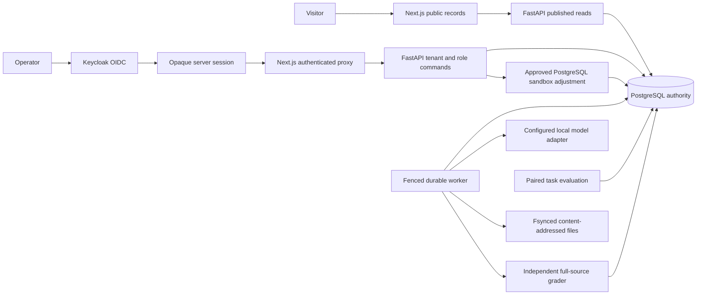

# Kairos build002: implemented boundaries

The opening architecture preserves build002. Later decisions describe repository investigations and evaluation. Build005 delivery adds the reviewer boundary below; see [DECISIONS.md](DECISIONS.md) and [the current report](docs/FINAL_REPORT_005.md).

The active product is a local Next.js, FastAPI and PostgreSQL workbench with a separate durable worker, local model adapter and Keycloak OIDC provider. All published tasks are synthetic. [The legacy review](docs/LEGACY_REUSE_REVIEW.md) records prototype defects and reuse decisions; legacy Go ingestion is not in this execution path.

## Decisions and their reasons

### D20 — One durable command authority

PostgreSQL stores command receipts, reference runs, job state, memberships, approvals and reports. Tenant-scoped keys bind canonical request digests; changed payloads conflict rather than masquerading as duplicates. HTTP success follows commit. Reference runs are bounded and execute inside a short transaction; network inference runs outside it. Synchronous commit is enforced and disabled fsync is rejected.

This avoids an unmeasured multi-language ingest hop and makes the acknowledged unit explicit. A memory-buffer acknowledgement cannot prove persistence. The legacy Go handler has additional request/drain and overflow ambiguities, so its transaction idea is reused without promoting its advertised guarantees.

### D21 — Durable intent, fenced ownership and explicit unknown outcomes

Jobs commit before HTTP202. Workers claim through `FOR UPDATE SKIP LOCKED`, bounded attempts and monotonic fencing tokens. PostgreSQL `clock_timestamp()` owns lease/deadline decisions, including checks after row-lock acquisition. Worker host clocks do not decide authority.

The worker commits dispatch intent before a model call, captures its response afterwards, then grades. The current contract allows at most one model dispatch per job, three claims, a180-second deadline and a120-second lease. A captured response can continue only when checkpoint/source fingerprints match. A dispatched call without a captured response becomes UNKNOWN and is never automatically redispatched. Cancellation is cooperative and cannot undo a call already sent.

The cost is lower automatic recovery than a blind retry loop. The benefit is an honest outcome when the provider may have performed work. Actual SIGKILL drills separately cover ambiguous dispatch and continuation from a known response.

### D22 — Capture raw evidence and calculate amounts deterministically

The local model classifies refund, zero or abstain. A deterministic tool calculates cents from verified order facts. Strict unmodified JSON parsing rejects malformed output, extra fields, duplicate keys, unsupported identifiers and missing required citations. The independent grader sees complete source facts even if selected model context omits an exception.

Exact rendered requests, raw responses, runtime metadata and model-file fingerprints remain available. Content-addressed blobs use temporary writes, file fsync, atomic replacement and directory fsync. Authenticated reads require job ownership and an actual object reference; digest possession is insufficient. Local hashes detect correspondence failures, not privileged history rewrites. Database rollback can leave unreferenced blobs; retention cleanup remains future operational work.

### D23 — Identity and membership are distinct authorities

Authlib and PyJWT implement protocol and token validation around one configured Keycloak issuer. Authorization-code login uses PKCE, state, nonce and browser binding. Browser sessions are opaque HttpOnly cookies backed by hashed server-side session records; provider tokens are not exposed in browser JSON. Membership in PostgreSQL supplies tenant and role, and each request rechecks active membership.

Operators may issue ordinary write commands; admins approve/revoke sandbox proposals. Viewer writes, missing membership and cross-tenant access are denied. Cookie mutations require the configured Origin. Production requires OIDC and HTTPS configuration, and does not accept developer bearer credentials. Local logout revokes the Kairos session, not every provider SSO session. See [identity migration limits](docs/IDENTITY_BOUNDARY.md): subjects are scoped to one trusted issuer per installation; multi-issuer membership is unsupported.

### D24 — Approval binds a reviewed proposal, not a reusable permission

A passing positive reference draft can become a sandbox proposal bound to tenant, source run, decision digest, order and amount. Approval names the current version and expires after15minutes. Dispatch locks and rechecks the version, approval and source decision. The target adjustment, effect command result and receipt commit in PostgreSQL, with stable tenant/order identity preventing a second adjustment from an equivalent fork.

A lost response after commit reconciles to the same receipt. Conflicting target content fails. Forks and recorded playback inherit no approval and dispatch no effects. This works because target and authority share a transaction. An arbitrary external payment API would need its own idempotency/reconciliation contract and explicit unknown states; no such commercial integration is implemented.

### D25 — Noninferiority requires positive evidence

Each paired task contributes a bounded difference in [-1,1]. The fixed Hoeffding radius is `sqrt(2 * log(2 / alpha) / n)` with alpha0.05. The predeclared acceptable loss is0.10 and minimum holdout count1,024. PASS requires the lower bound above−0.10; FAIL follows a hard invariant failure or an upper bound below−0.10; other cases are INCONCLUSIVE. Insufficient evidence cannot approve a candidate.

This conservative finite-sample choice avoids labeling an exploratory bootstrap sign proportion as calibrated safety evidence. The sampling unit is a precommitted independent seeded procedural task draw, not repeated generations of the same task counted as independent. Inference applies to that synthetic generator only. No optional stopping or bootstrap/Holm qualification claim is made. Hard checks and row retention keep schema/provider failures visible.

### D26 — A recruiter journey is a source-reading journey

The dark public site moves from an interactive recorded-context incident to event inspection, durable model responses and task-level release reports. The private workbench adds actual identity and bounded actions. API errors render unavailable states, and active routes do not invent canonical fallback data. URLs retain selected incident events; context controls, filters, keyboard access and narrow-screen layouts make the frontend more than a metric wall.

Source provenance and limitations sit beside verdicts. A successful transport is distinct from a passing task. The initial model failures are a debugging story, not a hidden blemish. Visual design does not substitute for independent usability evidence.

## Storage and operational boundaries

`schema.sql`, `schema_jobs.sql`, `schema_identity.sql`, `schema_effects.sql` and `schema_evaluation.sql` are additive, idempotent startup schemas. Integration tests create isolated schemas. A restore drill imports a PostgreSQL dump into a fresh database and applies current initializers twice to check compatibility and row preservation. This is not a general migration rollback framework. The combined recovery drill exports a locked database snapshot, backs up exactly its referenced blobs, restores fresh database/object targets and verifies each capture. Model weights and provider identity require their own backup policy.

Both API and web Docker images build from pinned bases. API and worker run as a non-root user; production Compose binds exposed application ports to loopback and requires an HTTPS identity provider. The TLS edge, secret manager, hosting account and provider production database remain deployment responsibilities. The CI definition runs actual PostgreSQL/provider integration and frontend checks; no hosted execution is inferred from a YAML file.

## Evidence and open external gates

The initial six durable model jobs grade0/6: four policy failures, one evidence-reference failure, one strict-schema failure. The development batch retains32 planned tasks,12 responses,20 provider errors and3 passing tasks; it fails its hard gate. Deterministic null/planted/reference-repair calibrations are separate and do not qualify this model. Local restore, bounded load, crash, audit and image-build receipts live in [build002 evidence](evidence/build002/) and are summarized in [the build report](docs/BUILD_002.md).

No cloud deployment, external customer adoption, model release qualification, WORM storage, general exactly-once effects, arbitrary checkpoint resume, high-volume capacity limit or model-research claim is established.

## D27 — Bound observed HTTP bytes before parsing

API ASGI middleware and the Next.js command reader reject observed bodies above32KiB, even without a truthful Content-Length. This protects the parsing boundary rather than trusting client metadata. Production edge buffering and request-time limits remain deployment responsibilities.

## D28 — Host-only sessions require one production public origin

The production website, login and callback share one HTTPS origin with edge path routing. Startup rejects split origins and incorrect authentication paths. This matches host-only session cookies and prevents a permanent sign-in loop. No cross-subdomain session redesign is implied.

## D29 — Separate bounded investigations from single-dispatch jobs

A new additive workflow supports several tool/model turns without changing existing jobs' one-dispatch contract. Investigation records pin a case/configuration snapshot; ordered pending/captured steps and CAS artifacts retain each attempt. Database-clock deadlines, fencing and a transaction advisory lock bound recovery and global concurrency. Unknown model dispatch is not retryable; known captured response continuation is.

## D30 — Exact replacements, restricted tools and independent containers

The small local model struggled with raw diff syntax. Exact unique source replacements allow mechanical diff rendering without host-authored repair semantics. Original snapshots, approved Python source paths,3 files/200 lines, registered commands and separate disposable verification copies constrain authority. Docker blocks runtime network/credentials/socket; internal process deadlines and output caps remain active after worker death. This is local defense in depth, not hardened hostile multi-tenant execution or verifier-test secrecy.

## D31 — Freeze descriptive comparisons, preserve integration failures

Six qualified historical cases split3development/3validation. Human localization and repository filtering are explicit. Finalv3 uses the runtime-proven nested schema; v1/v2 integration failures stay published. Both configurations repaired Django10914 only. Extra loop compute did not improve coverage. Frozen attempt IDs separate interactive publication from the evaluation cohort. Post-evaluation restrictions reject corrupt public patch downloads and prohibit runtime Docker pulls. Evaluated route/sandbox sources are archived and checked against the frozen lock; other frozen modules remain unchanged. See docs/BUILD_003.md.

## D32 — Local pinned inference and resource refusal

Official Qwen3-1.7B-GGUF Q8_0 with pinned llama.cpp runs one slot,4096context/1024output,thinking disabled and recorded generation settings. Local loopback only; no paid API fallback. Runtime/model files are hash-verified. Persistent investigation runtime stays under6GiB;4GiB free reserve blocks work rather than consuming the final disk space. Heavy frontend builds run while inference is stopped. Native installer currently supports macOS ARM64.

## D34 — Build004 control-plane and experiment boundaries

Use keyset pagination rather than offsets: equal timestamps are resolved by UUID, and later inserts do not shift an existing page boundary. Cursor scope is bound to the authenticated tenant or public listing. Downloads use the same read/integrity path in both visibility modes.

Serialize admission with the worker's global advisory lock before acquiring the tenant lock. This avoids cross-tenant queue overflow while preserving durable idempotent retries even when capacity is full. Capacity counts queued and running records together. The worker retains one global execution slot.

Pool investigation API connections with a maximum of eight and at most 32 waiting callers. The initial connection-per-operation load run failed with database disconnects; its measurements remain evidence. Pooling is a bounded response to connection churn, not proof of the failure's root cause. Transactions are never automatically retried across uncertain commits. Browser command identities handle ambiguous acknowledgements.

## D35 — Versioned repair feedback and original-source edits

V1–V3 keep their prior action, context and checking behavior. V4 edits identify a captured excerpt, complete-file digest and inclusive original line range. Mechanical diff construction remains server-owned. Read tools expose the original snapshot; candidate patches are separate evidence. Failed edits do not consume an applied-candidate slot, while every model call remains bounded. An accepted candidate is independently checked before requesting the next response.

V4 context measures the complete rendered chat template. It retains the issue, budgets and latest verifier verdict, dropping whole retrieved regions with recorded reasons. Oversized mandatory context is a visible failure, never malformed JSON or silent model fallback.

## D36 — Independent draft selection precedes verification

Six independent responses receive original evidence without previous candidates or check feedback. Structural validation selects the first two valid drafts. Only after all six are captured may checking begin. Both selected candidates are checked even if the first passes. A final saved selection links the displayed/downloaded patch to its check result. Rejected and unselected drafts remain in the event history. This strategy tests fresh-context drafting against feedback under matching ceilings, not necessarily equal consumption.

## D37 — Mechanical line boundaries, with original actions retained

V4 snapshot edits replace inclusive original-source line ranges. A missing final replacement separator is supplied by the renderer; indentation, expressions and semantics are never corrected. The original action, rejected edits, rendered unified diff and verifier result remain captured. Development revision 1's six newline rejections remain preserved; revision 2 is a separate archived configuration. Python syntax is checked before applying a candidate, and zero-exit verification requires a complete nonzero test-run marker for new study recipes.

## D38 — Capacity experiments retain uncertain commands

The first harness abandoned identities after uncertain acknowledgements and cancellation. During an outage this could strand queued work and cause unplanned quota rejections. The corrected harness retains the same command until it receives a durable receipt, then retains its cancellation target until confirmation. Raw requests stream to disk; only latency values and counters remain in memory. Original measurements and their misleading `expected_quota_rejections` field remain preserved, accompanied by corrected analysis. A quiet repeated protocol is separate evidence, not deletion of the failed mixed-workload soak.

## D39: Bound public comparison reads

A live production homepage check briefly returned unavailable although all 36 individual records validated. Code review identified an independent request-amplification problem: a comparison loaded all other frozen records before filtering by case, and visible record links could prefetch more comparisons. Frozen cohort metadata now maps record IDs to task IDs. The server reads only matching peers, still validating source/configuration identity after retrieval. Full-cohort reads use four concurrent requests, and dense record rows disable eager prefetch. An isolated browser regression requires three distinct records for a three-strategy case. Three subsequent real production homepage loads and desktop/mobile evidence checks passed. The initial transient trigger was not conclusively isolated; no claim that every availability failure is solved follows from this correction.

## D40: Recover exact executable environments; preserve failed outcomes

Two recorded pytest checks failed because the registered image index was unavailable. Restore the historical executable platform from local BuildKit blobs with SHA-256 verification, preserving its image index identity and a separate retention tag. Disclose the missing optional provenance attachment. Reference smoke tests confirm the environment works; they do not replace frozen agent outcomes. Local inference launch checks all registered exact image identities before dispatch. Saved-evidence inspection does not need a model or verifier images.

## D41: Keep capacity runs separate and include every response

The complete project-quiescent follow-up met local targets across 435,270 requests; original and interrupted runs remain visible. The harness retains uncertain command identities, confirms cancellation and streams raw rows. Success percentiles never replace inclusive failure rates. The observed separate-project build predates measurement. Other shared-host activity was not exhaustively measured; no fully isolated-hardware or production-scale claim is made. No inference or identity-provider throughput is inferred.

## Build005 reviewer boundary

`KAIROS_EVIDENCE_MODE=live|recorded` selects one explicit server authority and defaults to live. Recorded readers validate original bytes, schemas, references, pinned snapshots and ordered steps before serving the shared inspector. They expose no login or private commands. Dynamic rendering honors the runtime mode. Live outages remain unavailable; recorded evidence is never an automatic substitute.

Reviewer services use a separate runtime, generated private credentials, database, issuer, artifact root and ports. Inherited application/database settings are cleared. Owner labels and recorded process identities control reuse and shutdown; conflicts are refused and volumes preserved. Captured artifacts are fsynced before database references commit. Repeated imports verify history instead of replacing it.

Repair preparation validates pinned source and applies the captured model patch in a newly built reviewed image under a separate build005 tag. Both image digests are recorded. A changed image is disclosed rather than replacing historical provenance. The maintainer reference remains verification material, never the agent result.

The web runtime image includes only curated public evidence. Actual image checks exercise non-root operation, durable commands, downloads, live outages and recorded behavior without an API. Clean-snapshot acceptance installs locked dependencies and uses an explicit Python interpreter. Existing fixture journeys and archive failure checks guard delivery regressions.

Build004 source was archived before delivery edits; its evidence remains untouched. Large raw measurements have a lossless indexed archive. The publication snapshot excludes credentials, sessions, dependencies, databases and weights. `scripts/verify_delivery005.py` checks manifests and archive members; `--bundle` includes the prepared publication archive. Packaging acceptance is new evidence, while capacity/recovery/restore and frozen model studies retain their original receipts. No external publication or hosted CI execution is inferred.
