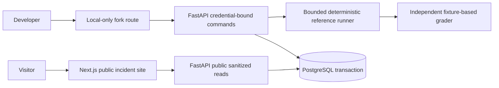

# Kairos build 001: implemented boundaries

Status: local vertical slice. The larger plan is in PLAN.md. Historical prototype claims are archived in docs/legacy-prototype-architecture.md and are not current guarantees.

## Why these choices

- **One Python authority:** the runner, command receipt, run document and seven events are committed in one short PostgreSQL transaction. HTTP success occurs after commit. The old Go memory-buffer ingest is outside this execution path. Another language would add a failure boundary before a measured bottleneck exists.
- **Database-backed command identity:** `(tenant_id, idempotency_key)` is unique. A canonical payload digest binds the key to its command, including parent lineage. Concurrent duplicates serialize on that receipt; changed payloads return 409. Failed transactions roll back both receipt and run.
- **Pure reference policy before a model:** a deliberate context omission produces an incorrect 480-cent proposal; an independent grader sees the complete scenario and rejects it. Preserving the exception produces zero. This proves the inspection workflow, not model quality. The separate local model probe passed 0/4 development cases and is developmental evidence only.
- **Separate presentation and execution:** public GETs expose only published synthetic records; private commands derive tenant identity from configured bearer credentials. The browser never receives that credential. The local fork proxy is disabled in production and only allows same-origin local requests.
- **Small bounded scenarios:** reference work is bounded and synchronous. Holding a transaction during a remote model call is not acceptable; model integration will require durable jobs, leases, intent/result capture and explicit unknown outcomes before it joins this path.
- **Local integrity checks:** run-document digests and ordered event hashes detect tested accidental changes. An administrator who rewrites the database can also rewrite these hashes. No immutable-history claim is made.
- **Fresh reruns:** a fork starts the full controlled scenario with a changed inclusion policy. Parent records remain untouched. Arbitrary checkpoint resume, external effects and replay against live tools are not implemented.

## State and data

`kairos_commands` owns command deduplication; `kairos_runs` owns tenant/publication metadata and the document digest; `kairos_events` owns `(run_id, seq)` uniqueness. Published fixtures contain no customer data. Reads verify document/event consistency. Tests use isolated temporary PostgreSQL schemas, not product rows.

The runner records: start, synthetic read, context assembly, context selection, draft decision, independent grade, stop. These are executed reference events, not hidden model reasoning. The UI stores selected event in the URL and shows included and omitted context.

## Remaining production work

Managed identity, authorization revocation, versioned migrations, async execution/quotas, model request capture, independent held-out evaluation, object storage, effects/approvals/reconciliation, backup/restore, load testing and outside-user feedback remain planned. No evidence supports throughput, uptime, statistical safety or customer-adoption claims yet.
