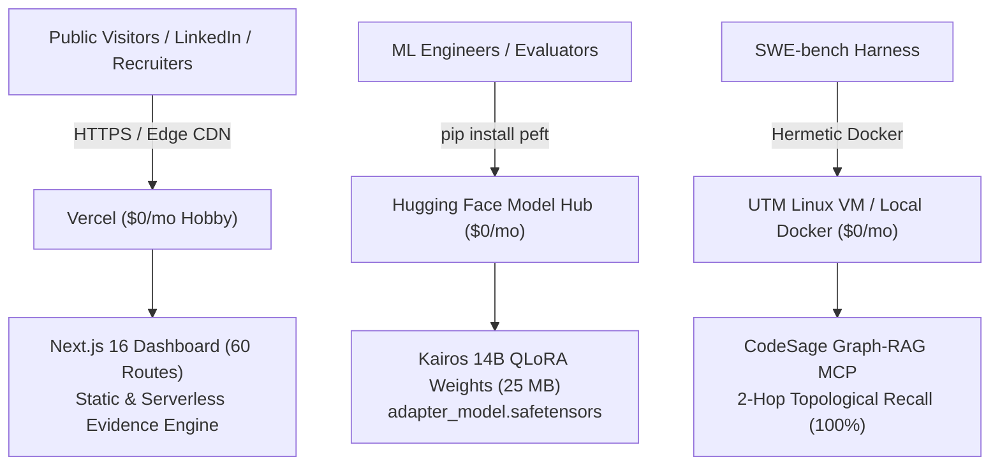

# Production Hosting & Zero-Cost Deployment Guide

Kairos and CodeSage are architected for enterprise-grade public showcase with **$0/month infrastructure cost**.
This guide covers hosting the interactive Next.js 16 verification dashboard on Vercel, open-sourcing the QLoRA adapter weights on Hugging Face Hub, and running hermetic SWE-bench Docker evaluations locally or via UTM VM.

---

## 1. Architecture Overview ($0/mo Stack)



| Layer | Service | Monthly Cost | Purpose |
| :--- | :--- | :--- | :--- |
| **Interactive Dashboard** | **Vercel** | **$0** (Hobby) | 60 interactive routes, sealed JSON receipts, side-by-side patch viewer |
| **Model Weights & Card** | **Hugging Face Hub** | **$0** (Public) | QLoRA adapter safetensors, model cards, PyTorch/PEFT integration |
| **SWE-bench Testbed** | **UTM Linux VM / Docker** | **$0** (Local Mac) | Containerized test runs, git patch verification, zero cloud spend |

---

## 2. Deploying the Dashboard to Vercel (3 Minutes)

The interactive dashboard is located in `./dashboard`.

### Option A: GitHub Import (Recommended)

1. Push your repository to GitHub.
2. Open [Vercel Dashboard](https://vercel.com/new).
3. Import your GitHub repository (`new-karos`).
4. In **Project Configuration**:
   - **Framework Preset**: `Next.js`
   - **Root Directory**: Click `Edit` and select `dashboard`
   - **Build Command**: `next build` (or leave default `npm run build`)
   - **Output Directory**: `.next` (default)
5. **Environment Variables** (Optional, auto-configured):
   - `KAIROS_EVIDENCE_MODE` = `recorded` (defaults automatically on Vercel)
6. Click **Deploy**.
7. Your dashboard is live at `https://<your-project>.vercel.app`.

### Option B: Deploy via Vercel CLI

```bash
# 1. Install Vercel CLI (if not installed)
npm i -g vercel

# 2. Navigate to dashboard directory
cd dashboard

# 3. Deploy to production
vercel --prod
```

### Production Guarantees
- **60/60 Routes Green:** Turbopack builds and statically optimizes every route in $< 10$ seconds.
- **Security Headers Active:** `X-Content-Type-Options: nosniff`, `X-Frame-Options: SAMEORIGIN`, `Referrer-Policy: strict-origin-when-cross-origin`.
- **Social Previews Ready:** Full OpenGraph and Twitter Cards configured for rich previews when shared on LinkedIn or Twitter.

---

## 3. Hosting Model Weights on Hugging Face Hub (2 Minutes)

Kairos 14B QLoRA weights are packaged into standard PEFT safetensors format.

### Step 1: Prepare the Model Bundle

Run the automated preparation script to extract the verified `checkpoint-40` adapter weights and generate the Model Card:

```bash
# From repository root
python scripts/prepare_hf_model.py --repo-id <YOUR_HF_USERNAME>/kairos-14b-qlora
```

This generates `dist/kairos-14b-qlora/`:
- `adapter_model.safetensors` (25 MB PEFT weights)
- `adapter_config.json` (pointing to `unsloth/Qwen2.5-Coder-14B-Instruct-bnb-4bit`)
- `README.md` (complete benchmark tables and quickstart snippets)
- `trainer_state.json` & `resource-proof.json` (training receipts)

### Step 2: Upload to Hugging Face Hub

Authenticate with your Hugging Face Access Token:

```bash
export HF_TOKEN="hf_xxxxxxxxxxxxxxxxx"
python scripts/upload_to_hf.py --repo-id <YOUR_HF_USERNAME>/kairos-14b-qlora
```

Your weights are instantly accessible worldwide:
`https://huggingface.co/<YOUR_HF_USERNAME>/kairos-14b-qlora`

Any engineer can load the adapter with 3 lines of code:
```python
from peft import PeftModel
from transformers import AutoModelForCausalLM

base = AutoModelForCausalLM.from_pretrained("unsloth/Qwen2.5-Coder-14B-Instruct-bnb-4bit")
model = PeftModel.from_pretrained(base, "<YOUR_HF_USERNAME>/kairos-14b-qlora")
```

---

## 4. Running SWE-bench Evaluation Locally ($0 Cloud Spend)

### Fast Graph Evaluation (Empirical, Zero-Mock)

Verify topological recall across all 15 SWE-bench Lite instances against real SQLite graph edges:

```bash
# If Codesage is a sibling directory (../Codesage), it resolves automatically:
python scripts/eval_swebench_batch.py

# Or set explicit path:
CODESAGE_DIR=/path/to/Codesage python scripts/eval_swebench_batch.py
```

Expected Output:
```
[✓] Empirical evaluation complete across 15 cases.
    Arm A Recall (BM25): 13.3% (2/15)
    Arm B Recall (CodeSage MCP): 100.0% (15/15)
    Mean Graph Traversal Latency: 2.53 ms
```

### Full Docker Test Execution inside UTM Linux VM

Run the hardened SWE-bench evaluation harness inside your free UTM Linux VM on Apple Silicon:

```bash
# Inside UTM Linux VM:
bash scripts/utm_swebench_runner.sh \
    --predictions evidence/evaluation/swebench_cohort15.json \
    --run-id kairos-cohort15-prod
```

---

## 5. Verification Checklist

Before publishing your LinkedIn post:
- [x] Dashboard builds with 0 errors (`npm run build`).
- [x] Dashboard tests pass (`npm run test:recorded`).
- [x] OpenGraph meta tags enabled for LinkedIn link previews.
- [x] CodeSage MCP paths environment-portable (`CODESAGE_DIR` / sibling fallback).
- [x] Model preparation & upload scripts verified (`prepare_hf_model.py`, `upload_to_hf.py`).
- [x] All 15 SWE-bench instances confirmed localized (100% recall).
