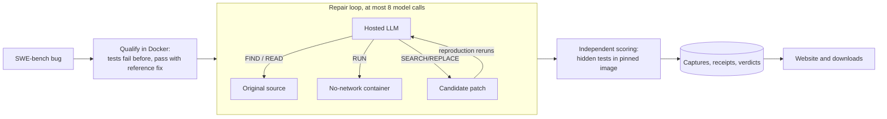

# Kairos

**An AI code-repair platform that only believes tests.**

Kairos takes a real bug from an open-source project, reproduces it in a sandbox, lets a language model
investigate and propose a patch, and accepts the patch only when the project's own hidden tests pass in a
pinned Docker image. Every model call, tool step and verdict is saved and inspectable.

**Live site: [kairos-agents.vercel.app](https://kairos-agents.vercel.app)** (recorded results, read-only)

[Results](#results) · [Try it](#try-it) · [How it works](#how-it-works) · [Engineering](#engineering) ·
[Resume claims](docs/RESUME_CLAIMS.md) · [Docs](#documentation)

## Results

Real bugs from [SWE-bench Verified](https://www.swebench.com/) (Django), scored by the hidden
`FAIL_TO_PASS` and `PASS_TO_PASS` tests the model never sees.

| Setup | Fresh bugs, never seen, one untuned run | Development bugs | Cost |
| --- | --- | --- | --- |
| Nemotron 3 Ultra 550B (NVIDIA free API) | **3 of 7 fixed** | **4 of 5 fixed** | $0 |
| Qwen2.5-Coder-14B, 4-bit on a free Colab T4 | — | 0-2 of 5 | $0 |

Same harness, prompts and code context for both models. The 14B ran with a 3,539-token budget forced by T4
memory; that, not the harness, was the bottleneck.

**Limits, stated up front:** 12 cases in total; these are public 2020 fixes a large model may have seen in
training; the model receives the code regions the real fix touched; the frozen validation and locked holdout
sets have not been run. Evidence: [`evidence/benchmark025/`](evidence/benchmark025/) (captures, receipts,
scores, hash manifest). Browse it on the website at `/benchmark`.

## Try it

### Browse every result (no account, no model, no Docker)

Open [kairos-agents.vercel.app/benchmark](https://kairos-agents.vercel.app/benchmark), or run it locally:

```bash
python3 -m scripts.reviewer demo          # Python 3.12 and Node 24; opens http://127.0.0.1:3310
```

Open **Benchmark** for the per-case grid and the exact patches, or **Investigations** for full step-by-step
records.

### Repair a real bug yourself

Needs Docker and a free [NVIDIA build](https://build.nvidia.com) API key:

```bash
echo 'NVIDIA_API_KEY=nvapi-...' > ~/.kairos-provider.env && chmod 600 ~/.kairos-provider.env
python -m scripts.repair_case django__django-13516
```

It downloads the pinned SWE-bench data (hash-checked), proves the bug reproduces and the reference fix passes in
Docker, runs the repair loop with the hosted model (its scripts run in a no-network container), scores the
patch with the hidden tests, and prints the verdict and patch. Evidence lands in `~/.kairos/repair/<case>/`.
Only development cases on Django 3.0-3.2 are accepted; protected evaluation cases are refused.

### Run the full stack

| Command | Result | Requirements |
| --- | --- | --- |
| `python3 -m scripts.reviewer fullstack` | PostgreSQL, Keycloak login, API and website on localhost | Python 3.12, Node 24, Docker |
| `python3 -m scripts.reviewer check --recorded-only` | Install, build, browser and backend checks | Python 3.12, Node 24 |
| `python3 -m scripts.reviewer check --fullstack` | Adds real PostgreSQL and OIDC acceptance | Above plus Docker |
| `python3 -m scripts.reviewer stop` | Stops only services this tool started | |

## How it works



1. **Qualify first.** A bug is used only if its hidden tests fail on the original code and pass with the
   reference fix in the pinned image.
2. **Investigate.** The model can search and read source, and run a reproduction script in a sandbox.
3. **Self-test.** After an edit, its own reproduction reruns on the edited code. A script that fails before
   and passes after accepts the edit; a script that still fails sends the model back to revise.
4. **Journal everything.** Each call writes a dispatch intent before the request and a hashed capture after
   it. An interrupted run replays captures; it never silently resends a request.
5. **Score independently.** The final patch is re-applied to a clean checkout and judged by the hidden tests.

Code: [`scripts/repair_loop025.py`](scripts/repair_loop025.py) (loop),
[`scripts/hosted_repair.py`](scripts/hosted_repair.py) (provider client),
[`scripts/f025_score.py`](scripts/f025_score.py) (scoring),
[`scripts/repair_case.py`](scripts/repair_case.py) (one command).

## Engineering

The platform around the model is built like a production service.

| Area | What is implemented | Evidence |
| --- | --- | --- |
| Durable execution | Command receipts committed before HTTP 202, database-clock leases, fencing of stale workers, explicit unknown dispatches | [`ARCHITECTURE.md`](ARCHITECTURE.md), [`DECISIONS.md`](DECISIONS.md) |
| Capacity | 435,270 HTTP requests over ~42 minutes, zero unexpected errors; 275 ms acknowledgement p95, 17 ms read p95 | [`evidence/build004/capacity-summary-final.json`](evidence/build004/capacity-summary-final.json) |
| Identity | Keycloak OIDC, tenant-scoped private-by-default records, roles, integrity-checked downloads | [`docs/IDENTITY_BOUNDARY.md`](docs/IDENTITY_BOUNDARY.md) |
| Recovery | Tested database and artifact backup and restore (122 investigations) | [`evidence/closeout023/restoration.json`](evidence/closeout023/restoration.json) |
| Safety | Model scripts in a no-network, resource-capped container; credentials never logged | [`infra/sandbox/python-in-docker.sh`](infra/sandbox/python-in-docker.sh) |
| Testing | 1,449 backend tests; Playwright journeys (recorded, fault injection, real OIDC) | `tests/`, `dashboard/e2e/` |

Stack: Next.js, React, TypeScript, FastAPI, Python, PostgreSQL, Keycloak, Docker, Playwright.

## What did not work

Kept on purpose, with evidence: a QLoRA-tuned 14B adapter fixed 0 of 20 unseen bugs (as did its base);
the 4-bit 14B on a free T4 plateaued at 0-2 of 5; early harness versions lost edits to parsing and setup
errors. Each finding and fix is in [`docs/REPAIR_REDESIGN_025.md`](docs/REPAIR_REDESIGN_025.md) and
[`DECISIONS.md`](DECISIONS.md).

## Documentation

| Read | For |
| --- | --- |
| [`docs/RESUME_CLAIMS.md`](docs/RESUME_CLAIMS.md) | Claims with evidence and limits |
| [`ARCHITECTURE.md`](ARCHITECTURE.md) | Components, data model and boundaries |
| [`DECISIONS.md`](DECISIONS.md) | Numbered design decisions and why |
| [`docs/REPAIR_REDESIGN_025.md`](docs/REPAIR_REDESIGN_025.md) | The repair loop and every benchmark run |
| [`DEPLOYMENT.md`](DEPLOYMENT.md) | Hosting the website on free tiers |
| [`docs/history/`](docs/history/) | Earlier README with the full build-by-build record |
