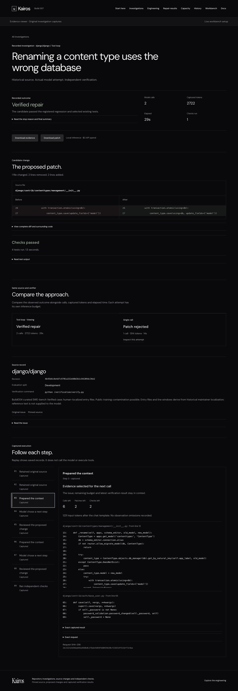
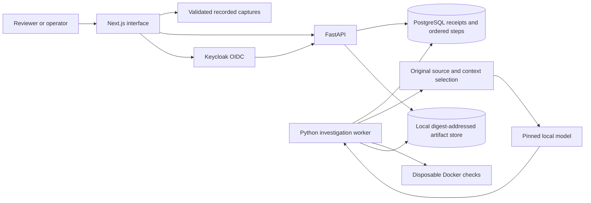

# Kairos

**A full-stack workbench for inspectable AI code-repair investigations.**

Kairos turns a repository defect into an evidence trail: the original source, context selected for the model, proposed patch, independent checks and observed outcome. Reviewers can inspect saved investigations without an account or live inference. An authenticated workbench provides durable submissions, progress, cancellation, fresh forks and publication.

The engineering focus is reliability around an uncertain model: accepted requests survive retries, stale workers cannot commit, interrupted inference is not silently repeated, and a plausible patch cannot approve itself.

[Review the product](#review-in-five-minutes) · [Measured results](#measured-results) · [Architecture](#architecture) · [Run locally](#run-locally) · [Documentation](#documentation)

## Review in five minutes

Start the recorded website with **Python 3.12 and Node.js 24**:

```bash
python3 -m scripts.reviewer demo
```

Open **[http://127.0.0.1:3310](http://127.0.0.1:3310)**. Installation time depends on dependency downloads and the local build. No Docker, database, model, API key or account is needed for this path.

| Step | What to do | What the website shows |
| --- | --- | --- |
| 1. Understand the product | Open **Start here** | A walkthrough of your actions, system behavior and expected results. |
| 2. Inspect an attempt | Choose **Inspect the development repair** in the guide | A real Django development case, pinned revision, recorded outcome and inference counters. |
| 3. Review the change | Read **The proposed patch**; expand source/context | Highlighted before/after lines and the exact source selected for the model. |
| 4. Check the evidence | Open the check result and strategy comparison | Test output, observed verdict, model calls, captured tokens and elapsed time. |
| 5. Keep the result | Download the patch and evidence bundle; open **Repair results** | Original captured evidence plus the complete fresh comparison, including unsuccessful attempts. |

**The visitor receives an inspectable result and a proposed patch for human review.** The recorded website does not run a new investigation or modify a repository. The featured development repair passed its registered checks; fresh validation remains **0/10**. A [DOM-verified visitor walkthrough](docs/showcase/VISITOR_WORKFLOW.md) records the exact visible results.

<details>
<summary>See the investigation interface</summary>



Captured from the tested build007 interface. Source, candidate, checks and recorded context remain separately inspectable. [Mobile walkthrough screenshot](evidence/build007/screenshots/first-investigation-mobile.png).

</details>

## Measured results

Latest delivery acceptance: **428 backend tests passed, six explicit skips**, plus **24 browser journeys**: eight evidence-viewer, eleven fault-fixture, four real-OIDC and one separately executed real-model journey. Frontend unit checks, lint, types and both builds passed. [Current acceptance and handoff](docs/showcase/FINAL_REPORT.md).

Each number links to a receipt and retains its measurement scope.

| Result | Evidence | Scope |
| --- | --- | --- |
| **435,270 HTTP requests over approximately 42 minutes**, zero unexpected errors | [Capacity summary](evidence/build004/capacity-summary-final.json) · [Protocol and failed runs](docs/CAPACITY_004.md) | Historical local control plane using real HTTP/PostgreSQL and isolated fixture identity/tasks. |
| **275.19 ms acknowledgement p95; 16.79 ms read p95** | [Capacity summary](evidence/build004/capacity-summary-final.json) | Ten-client, 30-minute soak; successful-response percentiles. Inference and OIDC throughput were not measured. |
| **Build007: 393 backend tests passed; six explicit opt-in skips** | [Full-stack acceptance](evidence/build007/checks/fullstack-acceptance.json) | Actual PostgreSQL; skips remain listed separately. |
| **Build007: 23 browser journeys passed** | [Recorded](evidence/build007/checks/recorded-browser.json) · [Fault fixtures](evidence/build007/checks/fixture-browser.json) · [Real OIDC](evidence/build007/checks/fullstack-browser.json) | Eight recorded, eleven isolated interaction-fault and four actual-OIDC journeys. |
| **110 tests, one upstream skip**, saved Django patch reproduced | [Reproduction receipt](evidence/build007/repair-reproduction.json) | Original model-generated Django10914 patch, fresh source and disclosed rebuilt-image difference; no new inference. |
| **122 recorded investigations; 1,243 original artifact blobs** | [Evidence inventory](evidence/build007/presentation.json) | Includes preserved successes, failures and interrupted/unsuccessful development attempts. |
| **Fresh repair study: 0/10 verified** | [Study results](dashboard/public/advancement/results.json) · [Qualification](evidence/build007/qualification.json) | Five qualified Django/pytest cases; baseline 0/5 and loop 0/5. One development repair is separate. |

The capacity workload used closed-loop clients with 50 ms pacing between command cycles. The successful quiet repeat retained the earlier failed and interrupted runs. It measures one finite local configuration, not maximum saturation throughput or production scale.

A separate clean checkout in a path containing spaces passed locked installation, builds and 19 recorded/fixture browser journeys: **277 backend tests passed, 122 environment/opt-in skips**. This is a separate invocation from full-stack acceptance. [Clean-checkout receipt](evidence/build007/checks/clean-acceptance.json).

## What the project demonstrates

| Engineering area | Implemented behavior |
| --- | --- |
| Frontend | Readable evidence inspector, highlighted patch views, keyboard operation, 390 px layouts, stale-response rejection, stable command identities across reloads and bounded polling. |
| API and authorization | FastAPI contracts, OIDC/server sessions, explicit tenant memberships and roles, private-by-default records, admin publication and integrity-checked downloads. |
| Durable execution | PostgreSQL command receipts committed before HTTP 202; database-clock leases, fencing, captured step recovery and explicit unknown dispatches. |
| Data and storage | Ordered investigation steps, content-addressed local artifacts, file/directory fsync, checksum validation and tested database/artifact restoration. |
| Agent workflow | Original-source handles, constrained line edits, selected context and omissions, immediate server-owned checks, duplicate-candidate reuse and bounded stopping. |
| Operations | Queue and pool admission limits, explicit migrations, separate runtime credentials, lock/statement deadlines, fault drills and owned-resource setup/shutdown. |
| Evaluation | Baseline/reference qualification before inference, locked cases/configurations, retained exclusions and attempts, and separate software/model outcomes. |

## Architecture

The active investigation path uses **Next.js/React/TypeScript, FastAPI/Python, PostgreSQL/psycopg, Keycloak OIDC, local llama.cpp inference and disposable Docker verification**. Recorded inspection runs directly from validated public captures.



PostgreSQL owns request identity, execution state and artifact references. The local artifact store persists exact bytes before a durable reference is committed. This is not an atomic transaction across the database and filesystem; a failed transaction may leave an unreferenced blob.

[Architecture, data model and request sequence](docs/showcase/ARCHITECTURE.md) · [API and operating guide](docs/showcase/OPERATIONS.md) · [Design decisions](DECISIONS.md).

### Decisions worth inspecting

- **Commit before acknowledging.** A request is accepted only after its durable receipt commits; an in-memory acknowledgement would not prove capture.
- **Keep uncertainty explicit.** Dispatch intent precedes model execution. A missing captured response remains unknown instead of triggering an unsafe resend.
- **Fence stale workers.** Database time avoids host-clock disagreement; fencing rejects late writes after lease changes or cancellation.
- **Bind edits to original source.** Captured handles, source digests, line bounds, path rules and syntax checks constrain patch construction.
- **Let checks decide.** The model proposes source changes; registered verification runs independently. A reference repair is never counted as an agent result.
- **Separate saved and live authority.** Recorded mode is explicit. A live API outage produces an error rather than replacement evidence.

### Bounded failure handling

One investigation executes globally per installation. Admission allows at most **24 queued/running globally and six per tenant**. The active API pool has at most eight connections and 32 waiting borrowers, with a five-second acquisition limit. Restricted reviewer runtime connections have two-second lock, 15-second statement and 30-second idle-transaction deadlines.

Actual drills returned **HTTP 503 after 2.01 seconds** under a held lock, recovered the original command identity, rejected excess pool waiters and preserved all 46 study records after a DB restart. [Operational receipts](evidence/build007/operational-drills.json).

## Run locally

From a clean checkout, choose one mode at a time. Ports are localhost-only; conflicting resources are preserved.

| Command | Result | Requirements |
| --- | --- | --- |
| `python3 -m scripts.reviewer demo` | Recorded website at port 3310 | Python 3.12, Node 24 |
| `python3 -m scripts.reviewer fullstack` | Isolated PostgreSQL 55434, Keycloak 8090, API 8310 and website 3310 | Above plus Docker |
| `python3 -m scripts.reviewer repair` | Reproduce the saved Django patch in a disposable environment | Python 3.12 and Docker |
| `python3 -m scripts.reviewer check --recorded-only` | Locked install, frontend/build, recorded/fault browsers and backend checks with explicit DB skips | Python 3.12, Node 24 |
| `python3 -m scripts.reviewer check --fullstack` | Add real PostgreSQL/OIDC acceptance | Above plus Docker |
| `python3 -m scripts.reviewer stop` | Stop only owned services; preserve volumes | Existing reviewer state |

Stop the running reviewer mode before switching modes or running checks. Generated credentials remain under ignored `.runtime/reviewer005`; use the synthetic local accounts without publishing their credential file. Full-stack setup applies migrations with a separate owner credential, then starts a restricted runtime role.

For real model execution with an existing prepared cache:

```bash
python3 -m scripts.reviewer fullstack \
  --runtime .runtime/live-showcase008 \
  --with-inference \
  --model-cache .runtime/investigations \
  --session-seconds 900
```

Sign in, select a registered development case and queue an investigation. The command connects the real worker and pinned local model, validates prepared assets and bounds the session to 15 minutes. The new browser-submitted Django demonstration produced a candidate in **two model calls** and passed **four independent tests**. [Actual execution receipt](evidence/docs008/live-execution/receipt.json) · [Setup and troubleshooting](docs/showcase/OPERATIONS.md#live-repair-execution).

Default full-stack setup starts authenticated services with inference off. Live execution is an explicit opt-in using prepared source, reviewed verification and pinned weights. Operators choose registered task IDs; arbitrary URLs and filesystem paths are excluded from the API.

## Repair workflow and outcomes

V7 allows at most **six model calls, two applied candidates, two check runs and 600 seconds**. The model can search original source, read captured regions, propose edits or return a final result. Kairos immediately checks an accepted candidate; verification commands are registered, not arbitrary model shell commands.

Checks use disposable, non-root containers without runtime network or Docker socket access, with a read-only root filesystem, two CPUs, 1 GiB memory and a 120-second check limit. Source paths and digests are validated before edits; original checkouts remain untouched.

A verified repair requires a reproduced baseline regression, regression success after the model patch and passing relevant existing tests. Outcomes also include rejected patches, failed checks, environment failures, timeouts, cancellation and unknown dispatches. Replay only reads saved steps; a fork starts a fresh linked attempt.

Fresh v7 validation earned **zero verified repairs across ten attempts**. The six-case qualification target was also missed; five cases qualified within declared limits. Earlier **0/36** and **0/10** studies remain visible. Public historical cases may be contaminated, source entry files were human-localized and the successful development issue supplies a repair hint. These results support evaluation infrastructure and limited repair demonstrations, not broad coding competence or loop superiority.

The optional free API development pilot produced no proposal: a corrected Gemini request returned HTTP 503, and its uncertain dispatch was not resent. It is separate from the frozen local study. [Pilot receipt](evidence/free-model-pilot/result.json).

## Documentation

| Read next | Contents |
| --- | --- |
| [Visitor workflow and DOM evidence](docs/showcase/VISITOR_WORKFLOW.md) | Exact clicks, visible results, downloads, error states and the difference between inspection and a new repair |
| [Architecture](docs/showcase/ARCHITECTURE.md) | Component boundaries, data model, request/dispatch sequence, trust and durability trade-offs |
| [API, setup and operations](docs/showcase/OPERATIONS.md) | Authenticated/public endpoints, configuration, migrations, limits and troubleshooting |
| [Claims and résumé bullets](docs/showcase/CLAIMS.md) | Claim-to-receipt map and interview wording |
| [Capacity methodology](docs/CAPACITY_004.md) | Raw measurements, pacing, error denominators, failed runs and scope |
| [Final software report](docs/FINAL_REPORT_007.md) | Acceptance, reproduction, operational evidence and separate failed repair target |
| [Design decisions](DECISIONS.md) | Why implementation choices were made and what their evidence supports |
| [Five-minute demo](docs/showcase/DEMO.md) | A concrete interview walkthrough of source, checks, recovery and measured capacity |
| [Sharing the project](docs/showcase/LINKEDIN.md) | A scoped LinkedIn draft and a clear distinction between local review and a public URL |
| [Research applied](docs/showcase/RESEARCH.md) | Primary interaction and agent-engineering sources behind the copy and workflow decisions |

The active implementation is in `kairos_api/investigations/`, `kairos_api/migrations.py`, `kairos_api/identity.py`, `dashboard/` and `scripts/reviewer*.py`. Earlier Go ingestion, harness/engine modules and synthetic refund demonstrations are preserved historical work outside the active investigation request path.

## Evidence integrity and scope

Build007 software and model evidence remain frozen. This delivery adds clearer presentation, the recruiter documentation and an opt-in live-session bootstrap. Its receipt binds these changes to the preserved release. Verify the active checkout with:

```bash
python3 -m scripts.verify_showcase008
```

The verifier checks the original build007 archive, preserved API/worker source and the explicitly declared presentation/bootstrap changes. Acceptance and live execution have their own receipts; verification checks their byte bindings. [Documentation provenance](docs/showcase/PROVENANCE.md).

Hashes establish byte consistency against stored references, not signed or administrator-proof history. Candidate Python shares the registered test environment, so adversarial test-forgery resistance is not established. Measurements cover local operation; public hosting, production scale, customer adoption, model research and staff-level impact are not claimed. Hosted CI configuration exists; its hosted execution is not claimed.

Historical source, receipts, images and failed studies are retained. Credentials, browser sessions, installed dependencies and model weights are excluded from the release archive.
