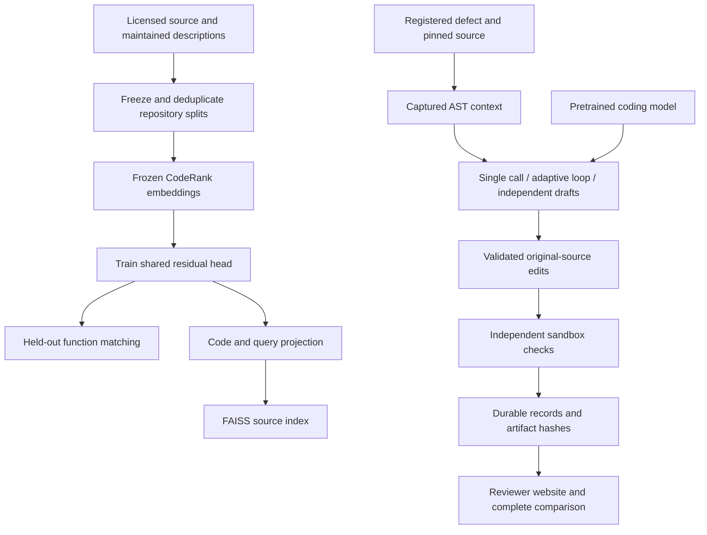

# AI engineering in Kairos

Kairos owns retrieval, representation adaptation, context assembly, bounded repair execution, verification and evaluation. It uses pretrained code-embedding and language models. The code generator is not a model trained by this project.

## What is learned

A shared rank-16 residual projection learns 24,576 parameters over frozen 768-dimensional CodeRankEmbed vectors:

`normalize(x + up(down(x)))`

Training uses 166 licensed Jinja function/description pairs, 135 Flask development pairs and 113 Click held-out pairs. Each function's own docstring is removed from its code input. Source revisions, original bytes, exact/near deduplication and repository-disjoint splits are frozen. Other functions are unjudged contrastive candidates, not independently confirmed irrelevant examples.

The initial uniform-negative profile and exactly two development revisions are retained. Development selected the hard-eight-negative profile at learning rate 0.0003 and step 100 of 200. Click scores entered only the final evaluator. The full optimizer, random generators, sampler and selected weights survived a real 37+163-step interruption with bitwise-identical state. The packaged CPU reproduction command also reproduced the exact selected weights and complete manifest.

Held-out MRR was 0.920823 for the base and 0.922526 for the head. Recall@5 was 0.964602 and 0.973451. The paired 95% MRR difference interval was [-0.011066, 0.014514], including zero. This is narrow function matching within one held-out repository, not demonstrated broad superiority or repair improvement.

Relevant code:

- `scripts/build_functions014.py`: licensed source admission, docstring removal, deduplication and split gates.
- `scripts/retrieval_adapter014.py`: contrastive objective, optimizer, checkpoint state and safe inference export.
- `scripts/source_variants014.py`: bounded training-only hard-negative revisions.
- `scripts/evaluate_source014.py`: separate held-out loader, paired outcomes and uncertainty.
- `scripts/trained_encoder014.py`: the same learned transform for code and queries, with an index identity bound to exact weights.

## What executes

The actual trained-encoder integration smoke encoded source and a query, applied the learned head to both, built and searched a FAISS index, and rejected a base-only query encoder for that index. Its synthetic source fixture tests integration, not retrieval quality. The 113-function evaluation supplies separate measured quality evidence.

The repair comparison holds initial AST localization constant across all three strategies. That separates strategy effects from representation changes. The learned head's effect on repair success is not measured in that comparison; connecting those claims would confound two changes. A future repair-level retrieval ablation requires a newly frozen cohort and equal context budgets, without retuning on this study's held-out outcomes.

## What the project does not infer

A working tool loop does not establish repair competence across arbitrary repositories. Passing registered checks does not prove adversarial test-forgery resistance. A small conditional bootstrap interval does not establish a safe release or production impact.

The earlier repair inventory contains too few distinct verified issue families for its original training-data gate. That gate stays closed. Source-only representation adaptation is a separate admitted dataset and experiment; it is not causal-language-model LoRA, training on failed repairs as positives, or a rewritten historical repair score. Language-model adapter training would first require separately reviewed, sufficiently diverse training targets and a measured free-GPU allocation. No such training is claimed.

The résumé claim is concrete: implemented and trained a small code-retrieval head, reproduced complete checkpoint recovery, integrated it with actual FAISS retrieval, and reported held-out base-versus-head results with uncertainty. Repair claims are earned separately from captured test outcomes.
