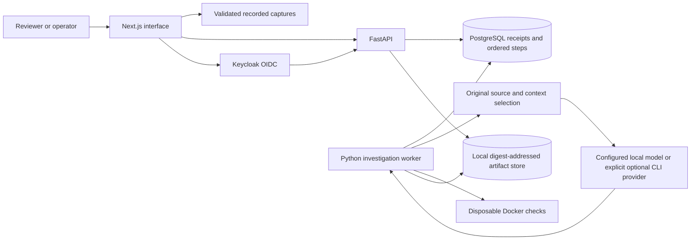

### Reproducibility closeout023

The exact `python3 -m scripts.reviewer fullstack` entry point was verified from a fresh local Git clone with fresh locked Python/npm dependencies. API and website returned HTTP200. Repeated setup reused owned services. A consistent database/artifact backup restored122 investigations and1197 distinct referenced objects into fresh targets with passing integrity checks. This is local same-host recovery, not a production-scale or disaster-recovery claim. Receipts: `evidence/closeout023/final-acceptance.json` and `restoration.json`.

### Completed project-excluded adapter comparison (unseen023)

The saved training5 adapter and its pinned14B base each attempted20 project-excluded Django/pytest cases. Independent scoring found **0/20 verified repairs for both arms**. All40 model captures were retained;13 structurally accepted candidates reached sandbox tests, while27 invalid patches were rejected. Two candidates broke pytest imports before tests could run. This does not demonstrate unseen adapter improvement. The earlier2/2 known-training result remains a separate learning check. No additional training or inference was performed during scoring.

# Kairos

**A full-stack workbench for inspectable AI code-repair investigations.**

Kairos turns a repository defect into an evidence trail: the original source, context selected for the model, proposed patch, independent checks and observed outcome. Reviewers can inspect saved investigations without an account or live inference. An authenticated workbench provides durable submissions, progress, cancellation, fresh forks and publication.

The engineering focus is reliability around an uncertain model: accepted requests survive retries, stale workers cannot commit, interrupted inference is not silently repeated, and a plausible patch cannot approve itself.

[Review the product](#review-in-five-minutes) · [Measured results](#measured-results) · [Architecture](#architecture) · [Production & Hosting ($0/mo Guide)](DEPLOYMENT.md) · [Run locally](#run-locally) · [Documentation](#documentation)

## Fresh Git and dependency verification — closeout023

A local sanitized release commit was bundled and cloned into an empty path containing spaces. Fresh locked npm and Python installations exposed a missing tokenizer dependency in the reviewer lock; the pinned dependency closure was corrected and a second release commit was cloned before retesting. The corrected fresh environment passed **1,318 backend tests, 16 subtests and four real OIDC browser journeys**, with **23 explicit skips**. A separate fresh-clone recorded demo passed all **20 browser journeys**. No push or public deployment was performed.

These results verify the recorded demo entry point and the full-stack components exercised through reviewer helpers. The exact full-stack CLI launch and a restoration drill were not rerun in this fresh clone. Existing system interpreters and the browser binary were reused. [Reproduction receipt and limitations](evidence/closeout023/reproducibility.json).

The corrected training5 adapter separately achieved **2/2 verified repairs on its two known training cases**, versus **0/2 for its pinned base**. This is a training-case sanity result, not unseen repair effectiveness. A new project-excluded comparison is undergoing independent qualification; no result is claimed before captured execution.

## Local release and optional publishing

The tested release runs locally. Public hosting and model publication have not been performed. [Deployment instructions](DEPLOYMENT.md) describe optional publishing, not a live deployment claim. The reviewer demo needs no model, database or account; authenticated full-stack operation is available through the separate reviewer command.

## Review in five minutes

Start the recorded website with **Python 3.12 and Node.js 24**:

```bash
python3 -m scripts.reviewer demo
```

Open **[http://127.0.0.1:3310](http://127.0.0.1:3310)**. Installation time depends on dependency downloads and the local build. No Docker, database, model, API key or account is needed for this path.

| Step | What to do | What the website shows |
| --- | --- | --- |
| 1. Understand the product | Open **Start here** | A walkthrough of your actions, system behavior and expected results. |
| 2. Inspect an attempt | Choose **Inspect the completed repair investigation** on the homepage | A real pytest development case, pinned revision, selected source and inference counters. |
| 3. Review the change | Read **The proposed patch**; expand source/context | Highlighted before/after lines and the exact source selected for the model. |
| 4. Check the evidence | Open the check result and strategy comparison | Test output, observed verdict, model calls, captured tokens and elapsed time. |
| 5. Keep the result | Download the patch and evidence bundle; open **Repair results** | Original captured evidence plus the complete fresh comparison, including unsuccessful attempts. |

**The visitor receives an inspectable result and a proposed patch for human review.** The recorded website does not run a new investigation or modify a repository. The new retrieval-assisted development investigation passed **22 tests** in five model calls. Historical fresh local-model validation remains **0/10**, measured separately. A [current visitor walkthrough and receipts](docs/EVALUATION_013.md#what-a-website-visitor-does) records the exact visible results.

<details>
<summary>See the investigation interface</summary>


Captured from the tested build007 interface. Source, candidate, checks and recorded context remain separately inspectable. [Mobile walkthrough screenshot](evidence/build007/screenshots/first-investigation-mobile.png).

</details>

## Latest backend and training evidence — measurement014

This working branch adds a complete frozen three-strategy study: **19 qualified cases, 57 attempts**, preserving all 24 original candidate dispositions. On 12 held-out Django/pytest issues, the bounded loop verified **7/12 repairs**, versus **1/12** for single-call and **1/12** for independent drafts. The loop used 35 model calls versus 9 for baseline; actual costs, exclusions and paired descriptive uncertainty are retained. All arms fixed AST retrieval. This is a small curated study, not an official full SWE-bench score or a learned-retrieval repair gain. [Complete outcomes](evidence/measurement014/comparison/report.json).

A separate retrieval experiment trained **24,576 parameters** on 166 source functions, selected on 135 development functions and evaluated once on 113 held-out functions. MRR changed from 0.920823 to 0.922526; the paired 95% difference interval includes zero. Checkpoint continuation and packaged reproduction were bitwise identical. This is trained retrieval adaptation; the separate coding-model training status is below. [Training evidence](evidence/measurement014/training/summary.json) · [Coding-adapter plan](docs/CODING_ADAPTER_014.md).

Real-service backend acceptance passed **1,014 tests and 16 subtests**, with four explicit skips. A separate optional CPU ML suite passed **39 tests and six subtests**, without skips. Fresh-source reproduction of the captured Django14752 patch passed all 19 tests, with no new inference. These are separate invocations, not additive test totals. [Backend receipt](evidence/measurement014/acceptance/backend-real014.json) · [ML checks](evidence/measurement014/acceptance/ml-mechanics014.json) · [Repair reproduction](evidence/measurement014/acceptance/repair-reproduction014.json).

The comparison viewer is integrated. Historical results retain their original attribution. Local acceptance is documented separately from any hosted CI run.

## Coding-model training and integration closeout

**Completed base-versus-adapter evaluation:** both verified **0/9 repairs**, with three other frozen cases unavailable in each arm. Eighteen inference calls completed; all nine baseline/reference reproductions passed. No adapter improvement was established. [Full methods, failures and evidence](docs/ADAPTER_EVALUATION_020.md).

A **Qwen2.5-Coder-14B QLoRA adapter** completed **40 optimizer updates on 100 public repair-supervision examples**. The 14B base remained frozen; **6,291,456 adapter parameters** were trained. The full result archive contains 58 hash-verified manifest members. This demonstrates real parameter-efficient training. It does not establish improved repair success: the admission bundle contains only two independent qualification captures, and the ten development outputs are not an untouched repair evaluation. The earlier narrative 80% grounding and p<0.001 are unsupported by the captured canonical validity fields. [Current closeout and evidence](docs/CLOSEOUT_020.md).

The CodeSage integration provides bounded repository graph context over MCP. Its historical 15/15 display used supplied caller annotations and installed-package indexes that were not bound to the issue revisions. It is preserved as development history, not a repair score or fair retrieval benchmark. The corrected issue-only diagnostic uses equal tokenizer budgets, records omissions and rejects these indexes for benchmark scoring. No model calls or patch checks run during that diagnostic.

Current engineering fixes include negotiated MCP initialization, request-ID validation, absolute deadlines, bounded frames, repository isolation, immutable demonstration captures and hash-verified adapter packaging. Local acceptance results and remaining evaluation prerequisites are listed separately in the closeout report.

## Measured results

Showcase008 delivery acceptance: **428 backend tests passed, six explicit skips**, plus **24 browser journeys**: eight evidence-viewer, eleven fault-fixture, four real-OIDC and one separately executed real-model journey. Frontend unit checks, lint, types and both builds passed. [Current acceptance and handoff](docs/showcase/FINAL_REPORT.md).

Each number links to a receipt and retains its measurement scope.

| Result | Evidence | Scope |
| --- | --- | --- |
| **435,270 HTTP requests over approximately 42 minutes**, zero unexpected errors | [Capacity summary](evidence/build004/capacity-summary-final.json) · [Protocol and failed runs](docs/CAPACITY_004.md) | Historical local control plane using real HTTP/PostgreSQL and isolated fixture identity/tasks. |
| **275.19 ms acknowledgement p95; 16.79 ms read p95** | [Capacity summary](evidence/build004/capacity-summary-final.json) | Ten-client, 30-minute soak; successful-response percentiles. Inference and OIDC throughput were not measured. |
| **Build007: 393 backend tests passed; six explicit opt-in skips** | [Full-stack acceptance](evidence/build007/checks/fullstack-acceptance.json) | Actual PostgreSQL; skips remain listed separately. |
| **Build007: 23 browser journeys passed** | [Recorded](evidence/build007/checks/recorded-browser.json) · [Fault fixtures](evidence/build007/checks/fixture-browser.json) · [Real OIDC](evidence/build007/checks/fullstack-browser.json) | Eight recorded, eleven isolated interaction-fault and four actual-OIDC journeys. |
| **110 tests, one upstream skip**, saved Django patch reproduced | [Reproduction receipt](evidence/build007/repair-reproduction.json) | Original model-generated Django10914 patch, fresh source and disclosed rebuilt-image difference; no new inference. |
| **122 recorded investigations; 1,243 original artifact blobs** | [Evidence inventory](evidence/build007/presentation.json) | Includes preserved successes, failures and interrupted/unsuccessful development attempts. |
| **Frozen local-model study: 0/10 verified** | [Study results](dashboard/public/advancement/results.json) · [Qualification](evidence/build007/qualification.json) | Five qualified Django/pytest cases; baseline 0/5 and loop 0/5. One development repair is separate. |

The capacity workload used closed-loop clients with 50 ms pacing between command cycles. The successful quiet repeat retained the earlier failed and interrupted runs. It measures one finite local configuration, not maximum saturation throughput or production scale.

A separate clean checkout in a path containing spaces passed locked installation, builds and 19 recorded/fixture browser journeys: **277 backend tests passed, 122 environment/opt-in skips**. This is a separate invocation from full-stack acceptance. [Clean-checkout receipt](evidence/build007/checks/clean-acceptance.json).

## Repair workflow follow-up

Repair010 local acceptance: **695 backend tests passed, six explicit skips; three real PostgreSQL/Docker journeys; 22 frontend unit checks and ten recorded browser journeys**. Lint, types, production build and dependency audit passed. [Current acceptance receipt](evidence/repair010/acceptance.json).

A separate optional workflow now supports **reviewed unresolved Python tasks without a known reference fix**, retains exact rejected edits, and requests **GPT-6.1-Sol through an existing local ChatGPT login**. It preserves the released browser/API provider defaults and enables no API billing.

Two previously captured model-generated development candidates passed **22 pytest tests and four Django tests** after a response-adapter correction. These are independently checked saved candidates, not a new fresh-validation score. The original failed attempts and dated local-model 0/10 remain inspectable. The website's **Repair workflow follow-up** shows their changes, checks and downloads.

```bash
python3 -m scripts.study010 doctor
python3 -m scripts.study010 validate-task --manifest /path/to/reviewed/registry.json --case-root /path/to/prepared/runtime --task-id reviewed-defect
python3 -m scripts.study010 run --manifest /path/to/reviewed/registry.json --case-root /path/to/prepared/runtime --task-id reviewed-defect --runtime .runtime/study010/reviewed-defect
```

We own the response-adapter defects: startup warnings were misclassified, and explanatory metadata rejected valid proposals. Both are fixed and covered by regression tests.

The repair010 attempt stopped at the existing account's usage limit. A later retrieval-assisted013 development investigation completed successfully, reported below. No GPU purchase or API billing fallback was needed. Uncertain earlier attempts were not resent. [Causes, mitigations, resources and exact closure criteria](docs/showcase/REPAIR_010.md#owned-gaps-and-closure-plan) · [Complete attempt ledger](evidence/repair010/attempts.json) · [Candidate check receipts](evidence/repair010/posthoc-summary.json).

## Source retrieval — Phase 1

Added revision-bound source retrieval with a pinned 137M code encoder, lexical search, hybrid fusion and exact local FAISS. On one exposed pytest issue, dense retrieval found the maintainer-changed file at rank five; AST and lexical controls missed it in their tested returned regions. All methods missed under the same four-region cap. This is a localization diagnostic; repair effectiveness remains separately measured.

The index covered 55 source files and 1,652 regions, built in 145.557 seconds on the 8 GiB M2 Mac. Original-source handles, encoding omissions, backend agreement, memory and exact receipts are inspectable. [Implementation and reproduction](docs/RETRIEVAL_011.md) · [All phases and resource decisions](docs/AI_ADVANCEMENT_PLAN_011.md).

## Iterative repair — Phase 2

A new optional workflow connects the pinned source index to `loop-v8`: **ten model calls, four applied candidates, four checks and 900 seconds**. `baseline-v8` permits one call/candidate/check. Original-source handles, immediate feedback, duplicate-check reuse, durable recovery and explicit unknown dispatch remain enforced. The existing website and worker defaults are preserved.

Retrieval selection is captured before dispatch; replay performs no execution. Query embeddings exit their own CPU process before model generation or container checks. Empty retrieval stops without silently adding registered file hints. A broader frozen study remains the next measurement; passing software fixtures does not create a repair score. [Workflow, commands and owned fixes](docs/LOOP_012.md) · [Acceptance receipts](evidence/loop012/acceptance.json).

## Retrieval-assisted investigation — Phase 3

**A real end-to-end development repair passed 22 pytest tests:** five model calls, one proposed patch, one independent check and **79.809237 seconds**. Captured usage was **66,744 input tokens and 402 output tokens**. The original source remained unchanged; owned heavy services stopped cleanly. [Inspect the source, patch and checks](docs/EVALUATION_013.md) · [Original result and provenance](evidence/evaluation013/pilot/receipt.json).

Open **`/repair-investigation`** in the reviewer website for retrieved-source inspection, highlighted changes, timeline, test output and exact evidence downloads. The run explicitly requested `gpt-6.1-sol` through existing ChatGPT login; a resolved model ID is unavailable. This exposed development case contains public repair hints and is not a fresh benchmark result or proof that the loop outperforms a baseline.

Current local software acceptance: **803 backend passes, 138 explicit environment/opt-in skips and eleven passing subtests; 12 recorded browser journeys, eleven interaction-fault journeys and 23 frontend unit checks**. Lint, types and the production build passed. Real database/OIDC checks run separately in hosted CI. [Acceptance scope and corrections](evidence/evaluation013/acceptance.json).

New tooling freezes an exposure-aware **24-candidate** Django/pytest cohort, validates complete comparison ledgers and prepares deduplicated, provenance-bound training exports. **At the013 freeze, zero new cases were qualified and no new multi-arm evaluation or cloud training had run.** Its123-record audit contained three distinct verified tasks. Measurement014 now provides the separately reported qualification, comparison and retrieval-head results above. The training-data gate remains closed until independent reviewed examples satisfy the frozen protocol. [Ordered gates and completion plan](docs/DELIVERY_PLAN_013.md).

## What the project demonstrates

| Engineering area | Implemented behavior |
| --- | --- |
| Frontend | Readable evidence inspector, highlighted patch views, keyboard operation, 390 px layouts, stale-response rejection, stable command identities across reloads and bounded polling. |
| API and authorization | FastAPI contracts, OIDC/server sessions, explicit tenant memberships and roles, private-by-default records, admin publication and integrity-checked downloads. |
| Durable execution | PostgreSQL command receipts committed before HTTP 202; database-clock leases, fencing, captured step recovery and explicit unknown dispatches. |
| Data and storage | Ordered investigation steps, content-addressed local artifacts, file/directory fsync, checksum validation and tested database/artifact restoration. |
| Agent workflow | Original-source handles, constrained line edits, selected context and omissions, immediate server-owned checks, duplicate-candidate reuse and bounded stopping. |
| Operations | Queue and pool admission limits, explicit migrations, separate runtime credentials, lock/statement deadlines, fault drills and owned-resource setup/shutdown. |
| Evaluation | Baseline/reference qualification before inference, locked cases/configurations, retained exclusions and attempts, and separate software/model outcomes. |

## Architecture

The active investigation path uses **Next.js/React/TypeScript, FastAPI/Python, PostgreSQL/psycopg, Keycloak OIDC, local llama.cpp inference, an explicit optional signed-in CLI provider and disposable Docker verification**. Recorded inspection runs directly from validated public captures.



PostgreSQL owns request identity, execution state and artifact references. The local artifact store persists exact bytes before a durable reference is committed. This is not an atomic transaction across the database and filesystem; a failed transaction may leave an unreferenced blob.

[Architecture, data model and request sequence](docs/showcase/ARCHITECTURE.md) · [API and operating guide](docs/showcase/OPERATIONS.md) · [Design decisions](DECISIONS.md).

### Decisions worth inspecting

- **Commit before acknowledging.** A request is accepted only after its durable receipt commits; an in-memory acknowledgement would not prove capture.
- **Keep uncertainty explicit.** Dispatch intent precedes model execution. A missing captured response remains unknown instead of triggering an unsafe resend.
- **Fence stale workers.** Database time avoids host-clock disagreement; fencing rejects late writes after lease changes or cancellation.
- **Bind edits to original source.** Captured handles, source digests, line bounds, path rules and syntax checks constrain patch construction.
- **Let checks decide.** The model proposes source changes; registered verification runs independently. A reference repair is never counted as an agent result.
- **Separate saved and live authority.** Recorded mode is explicit. A live API outage produces an error rather than replacement evidence.

### Bounded failure handling

One investigation executes globally per installation. Admission allows at most **24 queued/running globally and six per tenant**. The active API pool has at most eight connections and 32 waiting borrowers, with a five-second acquisition limit. Restricted reviewer runtime connections have two-second lock, 15-second statement and 30-second idle-transaction deadlines.

Actual drills returned **HTTP 503 after 2.01 seconds** under a held lock, recovered the original command identity, rejected excess pool waiters and preserved all 46 study records after a DB restart. [Operational receipts](evidence/build007/operational-drills.json).

## Run locally

From a clean checkout, choose one mode at a time. Ports are localhost-only; conflicting resources are preserved.

| Command | Result | Requirements |
| --- | --- | --- |
| `python3 -m scripts.reviewer demo` | Recorded website at port 3310 | Python 3.12, Node 24 |
| `python3 -m scripts.reviewer fullstack` | Isolated PostgreSQL 55434, Keycloak 8090, API 8310 and website 3310 | Above plus Docker |
| `python3 -m scripts.reviewer repair` | Reproduce the saved Django patch in a disposable environment | Python 3.12 and Docker |
| `python3 -m scripts.reviewer check --recorded-only` | Locked install, frontend/build, recorded/fault browsers and backend checks with explicit DB skips | Python 3.12, Node 24 |
| `python3 -m scripts.reviewer check --fullstack` | Add real PostgreSQL/OIDC acceptance | Above plus Docker |
| `python3 -m scripts.reviewer stop` | Stop only owned services; preserve volumes | Existing reviewer state |

Stop the running reviewer mode before switching modes or running checks. Generated credentials remain under ignored `.runtime/reviewer005`; use the synthetic local accounts without publishing their credential file. Full-stack setup applies migrations with a separate owner credential, then starts a restricted runtime role.

For real model execution with an existing prepared cache:

```bash
python3 -m scripts.reviewer fullstack \
  --runtime .runtime/live-showcase008 \
  --with-inference \
  --model-cache .runtime/investigations \
  --session-seconds 900
```

Sign in, select a registered development case and queue an investigation. The command connects the real worker and pinned local model, validates prepared assets and bounds the session to 15 minutes. The new browser-submitted Django demonstration produced a candidate in **two model calls** and passed **four independent tests**. [Actual execution receipt](evidence/docs008/live-execution/receipt.json) · [Setup and troubleshooting](docs/showcase/OPERATIONS.md#live-repair-execution).

Default full-stack setup starts authenticated services with inference off. Live execution is an explicit opt-in using prepared source, reviewed verification and pinned weights. Operators choose registered task IDs; arbitrary URLs and filesystem paths are excluded from the API.

## Repair workflow and outcomes

V7 allows at most **six model calls, two applied candidates, two check runs and 600 seconds**. The model can search original source, read captured regions, propose edits or return a final result. Kairos immediately checks an accepted candidate; verification commands are registered, not arbitrary model shell commands.

Checks use disposable, non-root containers without runtime network or Docker socket access, with a read-only root filesystem, two CPUs, 1 GiB memory and a 120-second check limit. Source paths and digests are validated before edits; original checkouts remain untouched.

A verified repair requires a reproduced baseline regression, regression success after the model patch and passing relevant existing tests. Outcomes also include rejected patches, failed checks, environment failures, timeouts, cancellation and unknown dispatches. Replay only reads saved steps; a fork starts a fresh linked attempt.

Fresh v7 validation earned **zero verified repairs across ten attempts**. The six-case qualification target was also missed; five cases qualified within declared limits. Earlier **0/36** and **0/10** studies remain visible. Public historical cases may be contaminated, benchmark entry files were seeded from reference-patch file headers (replacement text stayed outside model tools) and the successful development issue supplies a repair hint. These results support evaluation infrastructure and limited repair demonstrations, not broad coding competence or loop superiority.

The optional free API development pilot produced no proposal: a corrected Gemini request returned HTTP 503, and its uncertain dispatch was not resent. It is separate from the frozen local study. [Pilot receipt](evidence/free-model-pilot/result.json).

## Documentation

| Read next | Contents |
| --- | --- |
| [Visitor workflow and DOM evidence](docs/showcase/VISITOR_WORKFLOW.md) | Exact clicks, visible results, downloads, error states and the difference between inspection and a new repair |
| [Architecture](docs/showcase/ARCHITECTURE.md) | Component boundaries, data model, request/dispatch sequence, trust and durability trade-offs |
| [API, setup and operations](docs/showcase/OPERATIONS.md) | Authenticated/public endpoints, configuration, migrations, limits and troubleshooting |
| [Current development result and visitor flow](docs/EVALUATION_013.md) | Retrieval-assisted repair, cost, original captures, current acceptance and remaining measurement gates |
| [Claims and résumé bullets](docs/showcase/CLAIMS.md) | Claim-to-receipt map and interview wording |
| [Capacity methodology](docs/CAPACITY_004.md) | Raw measurements, pacing, error denominators, failed runs and scope |
| [Final software report](docs/FINAL_REPORT_007.md) | Acceptance, reproduction, operational evidence and separate failed repair target |
| [Design decisions](DECISIONS.md) | Why implementation choices were made and what their evidence supports |
| [Five-minute demo](docs/showcase/DEMO.md) | A concrete interview walkthrough of source, checks, recovery and measured capacity |
| [Sharing the project](docs/showcase/LINKEDIN.md) | A scoped LinkedIn draft and a clear distinction between local review and a public URL |
| [Research applied](docs/showcase/RESEARCH.md) | Primary interaction and agent-engineering sources behind the copy and workflow decisions |

The active implementation is in `kairos_api/investigations/`, `kairos_api/migrations.py`, `kairos_api/identity.py`, `dashboard/` and `scripts/reviewer*.py`. Earlier Go ingestion, harness/engine modules and synthetic refund demonstrations are preserved historical work outside the active investigation request path.

## Evidence integrity and scope

Build007 software and model evidence remain frozen. This delivery adds clearer presentation, the recruiter documentation and an opt-in live-session bootstrap. Its receipt binds these changes to the preserved release. Verify the active checkout with:

```bash
python3 -m scripts.verify_evaluation013
```

The verifier checks the original008 archive, preserved historical receipts and the declared CI009, repair010, retrieval011 loop012 and evaluation013 source overlays. Acceptance and live execution have their own receipts; verification checks their byte bindings. [Documentation provenance](docs/showcase/PROVENANCE.md) and [hosted CI correction](docs/showcase/CI_009.md).

Hashes establish byte consistency against stored references, not signed or administrator-proof history. Candidate Python shares the registered test environment, so adversarial test-forgery resistance is not established. Measurements cover local operation; public hosting, production scale, customer adoption, model research and staff-level impact are not claimed. [Pull request checks](https://github.com/Gaurav711cgu/kairos-agents/pull/1/checks) report hosted CI outcomes separately from the original Mac acceptance.

Historical source, receipts, images and failed studies are retained. Credentials, browser sessions, installed dependencies and model weights are excluded from the release archive.
