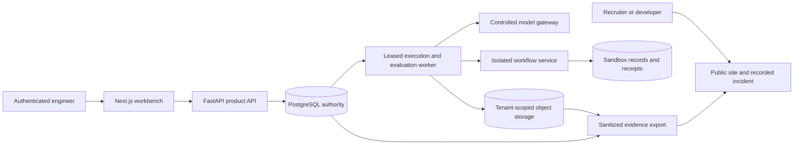

# Implementation plan

Status: build001 implements a bounded subset of P00/P01/P03; full milestone exits remain open. See BRAIN.md and the build evidence. Complete each acceptance gate before expanding scope. The website begins in P00 and evolves with real backend evidence; it is not an end-of-project skin.

## System boundaries



The trusted launcher controls sandbox permissions. Candidate code cannot grant itself egress, production credentials, or host mounts. Optional tracing observes execution; the execution ledger remains authoritative.

## Proposed source organization

```text
apps/web/                 public pages and authenticated workbench
services/api/             HTTP contracts, authentication, command handlers
services/worker/          job claims, runner adapters, evaluation execution
kairos/execution/         state transitions, command identity, checkpoint contracts
kairos/context/           manifests, compaction lineage, request reconstruction
kairos/effects/           approvals, effect lifecycle, receipts, reconciliation
kairos/experiments/       task manifests, graders, statistics, release policy
kairos/persistence/       scoped repositories and migration integration
scenarios/order-support/  controlled workflow API, records, policies, reference solutions
tests/contracts/          schema, transition, and adapter conformance
tests/integration/        real PostgreSQL/object-store and worker behavior
tests/faults/             deterministic crash windows and network faults
tests/browser/            product journeys, accessibility, reconnect behavior
evidence/                 manifests referencing captured artifacts and results
docs/                     architecture, guarantees, runbooks, decisions
```

These folders are a proposal. Do not create empty modules solely to match the diagram. Domain code must not import web UI or transport concerns.

## P00 — Validate task and design the first interaction

**Depends on:** D01–D04, D15. **Failures to cover:** F16–F19, F28–F30.

Work:

- Write a one-page discovery brief: user, decision they make, existing debugging workflow, failure costs, and successful outcome.
- Manually test representative straightforward, ambiguous, policy-exception, and insufficient-evidence tasks with the target model. Save actual requests, responses, and independent grades.
- Establish a simple rules/prompt baseline. Determine whether an agent loop provides value over one model call.
- Spike runtime/checkpoint boundaries against LangGraph. Choose one runner and record the decision before building durability plumbing.
- Produce low-fidelity layouts for public incident story, timeline/context inspection, fork composer, and evaluation report.
- Use clearly labeled design fixtures for layout exploration; do not publish them as runtime evidence.

**Exit:** a useful task and real failure are identified; reference scoring works; the first interaction is understandable without explaining the whole architecture. If the task does not justify a loop, change the workload or reduce the runtime.

## P01 — Authenticated vertical slice

**Depends on:** P00; D03, D05, D10. **Failures:** F01, F02, F12, F13, F22.

Build identity integration, organization/project membership, a create-run command, worker execution, persisted result, and browser run detail. Implement typed OpenAPI responses and stable error codes. Use same-origin routing where practical; keep model keys server-side. Define CSRF/session behavior for the selected auth library.

Minimum schema:

| Entity | Important fields/constraints |
|---|---|
| organizations, memberships, projects | tenant relationships; explicit roles; unique membership |
| runs | tenant/project; parent run/checkpoint; status; state version; configuration digest |
| commands | tenant + idempotency key; request hash; actor; accepted result |
| events | tenant/run/sequence unique; schema version; type; canonical payload digest |
| checkpoints | run/sequence; reducer/schema version; context/state references |
| context_manifests, blobs | ordered block references; tenant-scoped keys; verified digests |
| jobs/outbox | intent identity; attempt count; lease token/expiry; next attempt; terminal reason |
| proposals, approvals, effects, receipts | exact argument digest; permission binding; effect key; target receipt |
| task_sets, task_cases, experiment_trials, reports | immutable versions; configuration; grader; raw-result references |

Add entities when their milestone needs them. Start unpartitioned. Scope indexes by tenant and actual query pattern; examine plans on realistic data.

**Exit:** two users in different tenants execute the same journey and cannot inspect each other's runs through API, blob, stream, or worker paths. Browser loading, empty, auth, error, and retry states are explicit. A clean-checkout test uses actual PostgreSQL.

## P02 — Durable run ledger and bounded loop

**Depends on:** P01; D04–D07. **Failures:** F01–F06, F14, F15.

Implement a versioned transition reducer and one serialized authority per run. Proposed lifecycle:

```text
CREATED -> QUEUED -> RUNNING
RUNNING -> WAITING_APPROVAL | PAUSED | COMPLETED | FAILED | CANCEL_REQUESTED
WAITING_APPROVAL -> QUEUED | CANCEL_REQUESTED | FAILED
PAUSED -> QUEUED | CANCEL_REQUESTED
CANCEL_REQUESTED -> CANCELLED | RECONCILIATION_REQUIRED
```

Recovery is an explicit command with state-version checks, not an undocumented status edit. Terminal runs do not silently resume; an allowed retry/fork creates declared lineage.

Loop controls include maximum steps, elapsed deadline, tool deadline, bounded retries with jitter, context/token allowance, estimated spend reservations, cancellation checks, repeated-action detection, and explicit stop reasons. Repeated reads can be legitimate; use contextual repetition rules rather than banning all repeated calls.

Critical events record context assembly, model request intent/result, tool proposal/receipt, verification, approval, checkpoint, and stop. Streaming token fragments are optional telemetry; distinguish them from durably captured complete model responses.

An unknown provider response cannot be reconstructed by invention. A retry may produce a different answer and extra cost; record that provenance and reconcile billing where available.

**Exit:** duplicate commands yield the same accepted identity; conflicting payloads reject; crash-point tests preserve committed transitions; outages pause safely; loop limits terminate pathological behavior with clear reasons.

## P03 — Context inspection, recorded playback, and public incident

**Depends on:** P02; D08, D11, D15. **Failures:** F07, F08, F16, F23, F24, F29.

Store exact rendered requests and ordered context manifests. Record compaction input/output lineage, retrieval versions, reason category, token accounting method, tool schemas, and prompt version. Preserve evidence IDs across transformations.

Implement network-free recorded playback and deterministic verification replay. Fingerprints include mode, tool identity/version, normalized arguments, scenario snapshot, and relevant configuration. Missing/changed dependencies produce a visible unsupported state.

UI: virtualized timeline, URL-addressable selected event, context comparison, searchable evidence, provenance panel, and first-observed-divergence marker. Keep loaded rows bounded. Provide a readable accessible alternative to a visual diff.

Export the first sanitized genuine incident to the public site. Populate with actual trace content and explanatory editorial copy. No fabricated counts or outputs.

**Exit:** playback works with model/tool egress blocked; reconstructed request digest matches; refresh/deep link restores selection; the incident explains itself on mobile and keyboard. Site remains useful without authentication or model credits.

## P04 — Isolated forks, approvals, and effect reconciliation

**Depends on:** P03; D07–D10. **Failures:** F04–F06, F09–F13, F25.

Create fork lineage, copy/reference parent evidence without modifying it, and restore a declared initial scenario state. Use separate database credentials and separate sandbox state. Forks cannot inherit external write authorization.

Build the local adjustment service with a transactional unique effect key and receipt lookup. Simulate response loss after commit to test reconciliation against a real committed effect. Two approver sessions exercise stale-state conflict handling.

Define effect states such as PROPOSED, APPROVED, DISPATCHING, SUCCEEDED, REJECTED, and UNKNOWN_REQUIRES_RECONCILIATION. Attempt identity is separate from logical effect identity. Cancellation prevents future dispatch when its serialized decision wins; it does not undo an already committed effect.

Browser fork composer shows exactly what will change, which state is frozen, allowed tools, estimated cost, and approval requirements. Retry controls never hide an unknown effect outcome.

**Exit:** independent primary-state and egress canaries remain unchanged; all supported crash windows reconcile correctly; unsupported target semantics visibly escalate. Parent history and permissions remain intact.

## P05 — Independent evaluation and calibrated release policy

**Depends on:** P04; D13, D14. **Failures:** F17–F21.

Version task families: ordinary decisions, exceptions, ambiguous requests, stale policy, insufficient evidence, misleading tool text, and infrastructure faults. Distinguish agent quality failures from environmental failures while reporting both to users.

Run the same task cases under baseline/candidate with clean isolated environments and interleaved order. Keep external grader fixed. Reserve a held-out split by scenario/fault family; prevent candidate access to expected answers and grader internals where practical.

Initial ablations: verifier, policy-preserving compaction, retry/stop rules, and tool presentation. A tool-count comparison must preserve underlying capabilities, otherwise it measures a different task/interface. Report null improvements honestly.

Select fixed sample size after pilot variance/cost assessment. Analyze paired task differences with a justified clustered/hierarchical procedure. Include pass/fail/inconclusive, absolute qualification checks, and hard invariant failures. Compare statistical decisions with a simple threshold baseline under defined null/planted effects.

**Exit:** grader rejects known wrong outcomes; held-out results have raw artifacts; false-alert/power experiments support declared limits; report distinguishes descriptive intervals from hypothesis tests and release rules.

## P06 — Full-stack hardening and delivery

**Depends on:** P03–P05; D15, D16. **Failures:** F22–F27.

Harden read queries, SSE reconnect/cursors, malformed requests, resource quotas, export scope, CSP/content rendering, authorization changes, and concurrent updates. Notifications are hints; reconnect fetches authoritative missed events from persisted cursors. If retention invalidates a cursor, send a reset contract and reload a snapshot.

CI layers: deterministic unit/state-model tests; real-service integration/fault tests; browser journeys; production build; dependency/secret checks; preview deployment. Untrusted PRs use offline checks. Trusted approved-revision model jobs use controlled egress, narrow credentials, and spend limits.

Test additive migration with old/new application versions; exercise rollback compatibility. Perform off-host backup restore to a new environment, reconcile external receipts, and measure recovery. Implement PITR only if configured, tested, and justified.

Load test capture/query/UI separately from live model latency. Publish hardware, dataset, request arrival model, duration, error/rejection counts, queue age, memory, storage, and tail latency. Include recovery under fault, not only peak throughput.

**Exit:** clean-checkout and hosted CI are green; public site and private workbench work; restore and rollback have evidence; material limitations are published. No SLO is declared met without a defined window and measurements.

## P07 — Outside-user pilot and recruiter package

**Depends on:** P06; D01, D15. **Failures:** F28–F30.

Recruit a small number of willing users through explicitly authorized outreach or existing contacts. Observe their debugging workflow; do not infer adoption from page views. Give realistic tasks, record diagnosis correctness/time, and collect friction points. Use counterbalanced tasks where feasible to reduce learning effects; small samples remain formative.

Publish a concise case study, architecture walkthrough, incident postmortem, reproducible benchmark/evaluation commands, evidence download, and short demo recording. Resume bullets use measured scope and results only.

**Exit:** at least one outside user completes the core task, findings produce a documented change, and another engineer can reproduce a key result. This demonstrates initial user feedback, not enterprise adoption.

## Progress and scope controls

Estimate time/cost after P00/P01. Track active milestone, unfinished gate, failure IDs, and next command in BRAIN.md. Keep one primary vertical slice in progress. If a dependency adds days without improving the current acceptance gate, simplify or defer it and record why.

For every milestone, ship a browser-visible outcome and preserve evidence. Design fixtures are allowed during development; promotion to a public claim requires EVIDENCE.md verification.

## Build 001 checkpoint — 2026-10-11

P00 partial: cached-model developmental failures saved, independent reference grader and browser interaction implemented; customer discovery, aligned target-model tasks, runtime comparison and loop-value study remain open.

P01 partial: actual PostgreSQL persisted commands/events, developer credential tenant boundary and browser detail/fork work. Managed identity, memberships, durable worker jobs and migration system remain open. P03 interaction subset is demonstrable; exact rendered model request capture and full replay conformance remain open. P02/P04/P05/P06/P07 are not marked complete.

Next executable work: align task-fit probe with product task versions and error taxonomy; then define durable model intent/result jobs before remote execution. Keep model qualification, production auth, recovery and outside-user feedback as explicit gates.

## Build002 completion checkpoint — 2026-10-11

Local implementable scope completed and verified; see [BUILD_002.md](../BUILD_002.md). P01 includes real local OIDC and membership. P02 is a bounded durable single-call loop with tested intent/result/unknown semantics. P03 includes exact model capture, recorded playback and populated inspection. P04 includes fresh forks and approval/receipt sandbox. P05's calibrated three-state rule is implemented; configured model fails development and remains unqualified. P06's local packaging, audits, restore/load and manual browser gates passed; hosted CI/TLS/cloud operations remain external. P00 discovery and P07 outside-user adoption remain unproven; presentation artifacts are ready for review.

Next work is external validation, not another framework layer: run an unfamiliar-user study; choose a model that passes development provenance/schema checks; predeclare and run untouched model holdout; configure a real HTTPS deployment with backups/monitoring; measure pilot adoption. Do not mark those gates achieved from local artifacts.
