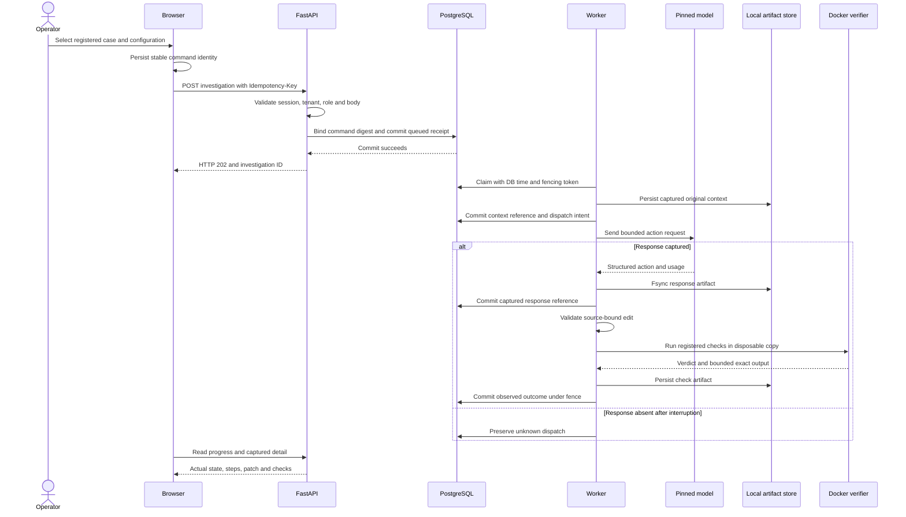

# Architecture and engineering decisions

Kairos separates request acceptance, uncertain model execution and independent verification. The current product is a local full-stack investigation system with a recorded reviewer mode. Its software acceptance and model-effectiveness results are reported separately.

## System boundaries

| Component | Responsibility | Source |
| --- | --- | --- |
| Next.js interface | Saved evidence, patch/context inspector, comparison, downloads and authenticated workbench | [`dashboard/`](../../dashboard/) |
| Browser transport and state | Aborted obsolete reads, selection generations, workspace-scoped pending commands and bounded polling | [`investigation-client.ts`](../../dashboard/lib/investigation-client.ts), [`hooks/`](../../dashboard/hooks/) |
| FastAPI | Request schemas, authorization composition and bounded HTTP bodies | [`app.py`](../../kairos_api/app.py), [`investigation routes`](../../kairos_api/investigations/routes.py) |
| Identity | Keycloak OIDC flow, server sessions, explicit membership and role enforcement | [`identity.py`](../../kairos_api/identity.py) |
| PostgreSQL repository | Durable command identity, state, ordered steps, budgets, global admission and fencing | [`repository.py`](../../kairos_api/investigations/repository.py) |
| Investigation worker | Recover captured steps, prepare context, dispatch, validate actions and verify candidates | [`worker.py`](../../kairos_api/investigations/worker.py) |
| Context/model adapter | Captured original regions, omissions, rendered token budgets and pinned runtime compatibility | [`context_v7.py`](../../kairos_api/investigations/context_v7.py), [`model.py`](../../kairos_api/investigations/model.py) |
| Workspace/verifier | Original-source authority, bounded patch construction, disposable registered checks and output capture | [`sandbox.py`](../../kairos_api/investigations/sandbox.py), [`patches.py`](../../kairos_api/investigations/patches.py) |
| Artifact store | Canonical JSON, digest-addressed local objects, atomic rename and file/directory fsync | [`BlobStore`](../../kairos_api/model_runtime.py) |
| Migration runner | Explicit checksummed revisions, catalog adoption and resumable missing-value operations | [`migrations.py`](../../kairos_api/migrations.py), [`backfill operations`](../../kairos_api/backfill_operations.py) |
| Reviewer tooling | Locked setup, owned resources, actual acceptance, saved repair reproduction and scoped shutdown | [`reviewer.py`](../../scripts/reviewer.py) |

Going through the active request path does not require the earlier Go ingestion service or synthetic refund harness/engine. Those modules and their history remain available, but they are not presented as active production dependencies. The current artifact store is a local filesystem implementation; S3/MinIO and an event bus are not active components.

## Request and execution sequence

This diagram describes the live workflow when a worker, source case and pinned inference runtime are prepared. The default full-stack reviewer starts the control plane with inference off. Recorded mode reads validated captures without PostgreSQL, identity, worker or model execution.

## Data model

The canonical schema is in [migration 0001](../../kairos_api/migrations/0001_build006_baseline.sql); later revisions explicitly expand/validate configuration values and add backfill receipts.

| Table | Stored responsibility |
| --- | --- |
| `kairos_investigations` | Tenant/command identity and digest, task/configuration snapshots, publication, status/outcome, counters, deadline, lease owner/token/expiry and parent lineage |
| `kairos_investigation_steps` | Ordered sequence, kind/name/state and captured request/result references |
| `kairos_investigation_artifacts` | Artifact metadata and investigation references; object bytes remain in the local store |
| `kairos_memberships` | Explicit subject-to-tenant role authority |
| `kairos_login_states`, `kairos_sessions` | OIDC login state and server-managed sessions; never exported as public evidence |
| `kairos_schema_migrations` | Applied revision, name, checksum, time, duration and catalog fingerprint |
| `kairos_data_backfills` | Versioned operation checksum, cursor, updated/skipped counters and completion state |

Status describes execution. Outcome describes the observed repair result. A completed investigation can report failed checks or no patch; terminal execution is not equivalent to a verified repair.

## Durable acceptance and recovery

**Idempotency.** A tenant-scoped key binds the command payload digest. An identical retry returns its original record. Reusing the key with a different payload returns HTTP 409. Browser pending-command state survives reload under the workspace/subject scope. This prevents duplicated accepted commands; it is not an exactly-once provider execution guarantee.

**Leases and fencing.** Claims use database time and a changing lease token. Writes validate owner/token/status/expiry. Cancellation changes authority so a stale worker cannot commit. The execution deadline is 600 seconds for the bounded loop; its lease is separately sized by the implementation. Cancelling cannot reverse a provider call that has already started.

**Dispatch uncertainty.** Intent is committed before inference. A captured response can be consumed after recovery. An intent without a captured result stays unknown; recovery does not infer that nothing happened and silently send again. Replay performs no tools or model calls. A fork is a fresh linked investigation, not arbitrary historical-step continuation.

**Artifact order.** The store writes canonical bytes to a temporary file, fsyncs it, atomically renames and fsyncs the containing directory. PostgreSQL commits references afterward with synchronous durability settings. A rollback can leave an orphan object. Loaders and downloads verify hashes, references, schemas and step order. An administrator who rewrites both references and bytes remains outside this consistency guarantee.

## Context and patch authority

V7 source blocks reference original captured source, not a mutable candidate. A proposal names a server-owned handle, inclusive line range and replacement text. Validation checks source identity/digest, captured bounds, approved paths, symlink/traversal escapes, overlaps, syntax and patch limits before creating a candidate.

Localization prioritizes explicitly named functions and bounded same-file callees. Context preserves issue, budgets and latest checks. Omitted regions and exact failure excerpts are recorded. Checks run immediately after accepted patches. A previously checked candidate reuses its captured result without spending another applied-patch/check slot. Two identical rejected proposals stop the attempt.

The bounded loop permits six calls, two applied candidates, two checks and 600 seconds. The model's v7 action schema exposes `search`, `read_file`, `propose_patch` and `final_result`; check execution is server-owned. Earlier protocols remain preserved and do not acquire new behavior retroactively.

## Sandbox and trust

Registered checks run in disposable Docker environments: non-root UID 10001, no runtime network, no Docker socket, read-only root filesystem, dropped capabilities, no-new-privileges, two CPUs, 1 GiB memory, PID limit 128 and a bounded temporary filesystem. Dependencies are prepared separately through reviewed recipes. The agent receives no arbitrary shell command tool.

Output uses bounded disk-backed capture. Existing display tails are limited to 24 KB per stream; current capture also retains exact base64 bytes and hashes within a combined 1 MiB ceiling. Exceeding the guard fails verification explicitly. Timeout captures preserve the bytes observed before termination and do not imply completed tests.

The trusted host worker owns Docker. Candidate Python shares the interpreter/environment with registered tests. Keeping reference fixes and hidden test material outside source tools does not establish resistance to hostile test forgery, nor does feedback-visible verification constitute an unseen final holdout.

## Backpressure and migration discipline

| Boundary | Implemented limit |
| --- | --- |
| Global execution | One running investigation per installation |
| Global admission | 24 queued/running investigations |
| Tenant admission | Six queued/running investigations |
| Active API connection pool | Eight connections, 32 waiters, five-second acquisition deadline |
| Restricted reviewer runtime SQL | Lock 2 s, statement 15 s, idle transaction 30 s |
| Migrator serialization | DB/schema advisory lock, ten-second acquisition deadline |
| Migration transaction | Lock 2 s, statement 60 s, synchronous commit |
| Backfill | Explicit missing-value operations in batches of 200 |

API/worker startup verifies compatibility and required durability settings without DDL or backfills. Setup owns migrations using a separate credential. Existing build006 schemas require catalog validation before adoption. Checksums, missing revisions, unknown future versions and unexpected catalog drift are rejected. Constraint expansion and validation have separate revisions. There is no automatic destructive downgrade or zero-downtime claim.

## What was tested

Read the [software aggregate](../../evidence/build007/final-checks.json), [fault drills](../../evidence/build007/operational-drills.json), [restored migration rehearsal](../../evidence/build007/adoption-restoration.json) and [browser matrix](../USER_JOURNEYS_007.md).

The scope is local correctness, measured control-plane capacity and reproducible evidence. General repair effectiveness failed the fresh target. Horizontal scale, production SLOs, external customer adoption, offsite recovery and organizational leadership require separate evidence.
