# What a visitor does and receives

Current acceptance uses the rendered website DOM, semantic controls, keyboard input and actual downloads. The revised evidence viewer passed all eight recorded-site journeys; a separate authenticated browser submitted and completed a real local-model investigation. [Live workflow receipt](../../evidence/docs008/live-execution/receipt.json). Final release acceptance is summarized alongside the preserved original build007 receipts.

## First-time reviewer

```mermaid
flowchart LR
    Home[Homepage] --> Guide[Start here]
    Guide --> Case[Inspect the development repair]
    Case --> Patch[Highlighted before and after]
    Patch --> Context[Captured original context]
    Context --> Checks[Registered check output]
    Checks --> Compare[Strategy outcome and cost]
    Compare --> Download[Patch and evidence downloads]
    Download --> Study[Complete fresh results]
```

| Action | Visible result | Result achieved? |
| --- | --- | --- |
| Open the homepage | “Follow a defect. Inspect its repair.” and “Evidence viewer · Original investigation captures” | Yes: product purpose and viewing mode are clear. |
| Open **Start here**; press Enter on the first disclosure | “You receive an inspectable trace immediately, without local setup.” | Yes: the walkthrough explains the next action and expected result. |
| Choose **Inspect the development repair** | “Renaming a content type uses the wrong database,” “Verified repair” and “Development” | Yes: same genuine case as the homepage, with provenance and scope. |
| Read **The proposed patch** | Original `save(update_fields={'model'})` and proposed `save(using=db, update_fields={'model'})` | Yes: highlighted source and candidate lines are separate. |
| Choose **Prepared the context** | “Evidence selected for the next call” and “Retrieved source excerpt” | Yes: context is readable without raw JSON. |
| Expand **Read test output** | Four tests and the captured verifier completion result | Yes: checks are inspectable. The original 110-test reproduction is separate. |
| Inspect **Compare the approach** | Actual call, token and elapsed totals beside both outcomes | Yes: compute consumption and observed results are visible. |
| Download evidence and patch | Original captured artifacts with integrity checks | Yes: usable files download without changing a working checkout. |
| Open **Repair results** | “Fresh evaluation: 0 of 10 verified repairs,” two 0/5 strategy results | Yes: all fresh outcomes and unsuccessful development revisions remain available. |
| Open **Workbench** from the evidence viewer | “Start a new investigation,” **Set up the live workbench**, **Explore investigations** | Yes: the user receives a working setup path; no fake login or command is offered. |
| Open **Capacity** | “435,270 requests. A complete 42-minute test.” plus the initial failed run | Yes: earned measurements and earlier failure evidence remain together. |
| Open a missing/invalid record | Explicit missing-record or invalid-identifier error | Yes: no replacement data is invented. |
| Use 390 px layout and keyboard controls | No horizontal document overflow; disclosure opens with Enter | Yes: tested mobile and keyboard interactions pass. |

The saved featured record is `e1fa91f8-7d8f-4249-b09b-ac4d5df64be8`. Its development check scope is four tests. Original Django10914 reproduction ran 110 tests with one skip. These are distinct evidence.

## Operator: actual new execution

Use the [live execution command](OPERATIONS.md#live-repair-execution) with the prepared cache. The following path was executed through real Keycloak, PostgreSQL, API, worker, pinned local model and disposable verification—not a fixture model.

1. Sign in through local OIDC using the privately generated account.
2. Select `django__django-11066` and **Tool loop · Checked revisions**.
3. Choose **Queue investigation** once. The browser received HTTP 202 and a durable command receipt.
4. Observe actual progress and newly captured steps.
5. Inspect the candidate and context. Two model calls produced one applied patch; registered checks passed four tests.
6. Download patch/evidence. The bundle matched the API record; patch and bundle hashes are in the receipt.
7. Replay saved steps. Replay returned zero network calls and zero tool executions.
8. Inspect at 390 px, then sign out. The private UI returned to sign-in.

**Observed result:** verified repair; 35.1 seconds between captured worker start and completion. [Desktop view](../../evidence/docs008/live-execution/live-result-desktop.png) · [Mobile view](../../evidence/docs008/live-execution/live-result-mobile.png) · [Candidate patch](../../evidence/docs008/live-execution/candidate.patch).

The source issue includes a fix hint and source entry files were human-localized. This exposed development demonstration is separate from the frozen 0/10 validation. Its model/worker and owned services were stopped afterward; data and volumes were preserved.

## Meaning of the result

The evidence viewer gives a reviewer a complete inspection path. The live workbench gives an operator an actual investigation, proposed source change when available, and captured verification outcome. Software acceptance and measured repair effectiveness have separate receipts. New submissions require the explicit live setup; the evidence viewer continues to serve original captures independently.
